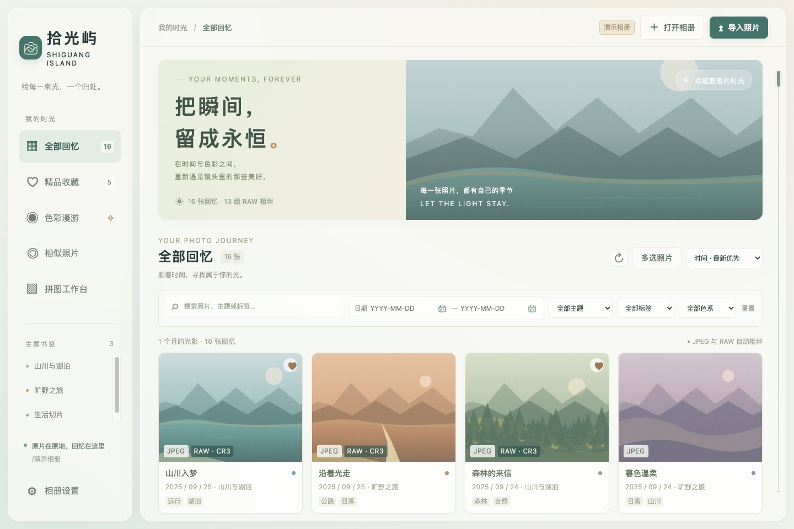
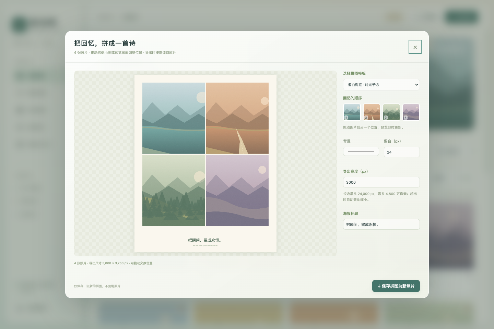

# Shiguang Isle · A Time Machine for Photography

[简体中文](README.md) · [English](README.en.md)

Give every captured moment a small island to return to.

Shiguang Isle (拾光屿) is a local desktop photo library for DSLR and mirrorless photography. Browse matching JPEG and Canon CR3 files together, keep originals on your own drives, find photographs by date, color, theme, or tags, and send either format to your preferred editor. The application interface is currently in Simplified Chinese; this guide describes its features in English.



This screenshot uses generated landscapes. It contains no real portraits, user originals, private paths, or real capture metadata. There are no real faces requiring blur.



The collage screenshot also contains only synthetic photographs.

## Installation

Download the package for your computer from [GitHub Releases](https://github.com/Undefeated-man/shiguang-isle/releases). Filenames start with `Shiguang-Isle-` followed by the version; the table shows their platform suffixes.

| Computer | Package suffix | Installation |
| --- | --- | --- |
| Apple Silicon Mac | `mac-arm64.dmg` | Open the disk image and drag the app into Applications |
| Intel Mac | `mac-x64.dmg` | Open the disk image and drag the app into Applications |
| Linux x64 | `linux-x86_64.AppImage` | Make the file executable, then run it |
| Debian / Ubuntu x64 | `linux-amd64.deb` | Open it in your software installer, or use `sudo apt install ./package-name.deb` |

The macOS release packages use ad-hoc signing. They have not been signed with an Apple Developer ID certificate or notarized by Apple. macOS may block the first launch; verify the download source and `SHA256SUMS.txt`, then allow it through System Settings → Privacy & Security if necessary. ZIP packages provide the same application in a portable archive.

Some Linux distributions require FUSE 2 for AppImage. Photoshop and Lightroom have no official Linux desktop editions; use the editor settings to select an executable installed on your machine.

## Features

| Feature | How it works |
| --- | --- |
| Color organization | Analyze image colors automatically and browse within a date range |
| Date and theme search | Limit dates, search theme names, and assign themes to individual or selected photographs |
| Similar photographs | Choose a directory and compare average-pooled RGB pixels using cosine similarity; adjustable granularity, estimated time, progress, and cancellation |
| Collages and posters | Vertical and horizontal strips, four-cell and nine-cell layouts, whitespace and film posters; drag to reorder and export a new JPEG |
| Favorites | Mark favorite photographs and browse them in a dedicated view |
| Individual and batch tags | Edit tags on one photograph or add tags to a selection |
| Shared filters | Date, color, theme, and tag restrictions work across all photos, favorites, color browsing, similarity results, and collage photo selection |
| Responsive window | Resize the window; the sidebar, gallery, and workspaces adapt to available space |
| Simple editing | Crop, rotate, mirror horizontally or vertically, and apply rectangular or elliptical pixel mosaics; overwrite a JPEG or save a new file |
| SD card import | Copy new photographs into a chosen memories root, use an existing or new theme, organize by capture date, and skip duplicate content |
| Batch selection and deletion | Multi-select, range selection, and select all filtered results; move files to the system trash after confirmation |
| Reveal selected files | Select matching JPEG / CR3 files in Finder on macOS; use a compatible FileManager1 file manager on Linux |
| Favorite synchronization to SD | Preview files to keep from favorites or the current selection, then move other JPEG / CR3 files into a recoverable `待删` batch with a journal |

Photo details display JPEG and its corresponding CR3 preview side by side. Each format has Photoshop, Lightroom, and system-open buttons. Browsing creates lightweight cached previews rather than full original copies.


The paired-preview screenshot uses generated photographs and sample metadata, with no real people or private capture information.

## Using the library

1. Choose a photo root. The app scans recursively and identifies JPEG / CR3 pairs using names, dates, and directory relationships while retaining the original file locations.
2. Filter by date range, color, tags, and theme. Use the favorites view to revisit your selected photographs.
3. Select multiple photographs to add tags, mark favorites, reveal files, or move files to trash. In a photo's details, choose JPEG or CR3 when handing it to an editor.
4. Open similarity search, choose a reference photograph and search directory, then select pooling granularity. Computation happens for that search; results can be filtered further by date and other shared conditions.
5. Open the collage workspace with multiple JPEG photographs, choose a layout, drag photographs into a new order, and export a new JPEG.
6. Use the editor to crop, rotate, mirror, or add rectangular and elliptical mosaics. Choose overwrite or save-as. Canvas exports do not retain the original EXIF; editing does not overwrite CR3 files.
7. Import from an SD card or another directory into your chosen memories root. Pick an existing theme or create one. Files are copied, sorted by capture date, and checked for duplicates; source files remain available.
8. Synchronize favorites or the current selection to an SD card. Review the keep and move lists first. Other photographs move into a `待删` batch on that card with their relative paths and a journal. Empty matches, ambiguity, or files changing after preview stop execution.

Moving files into `待删` preserves their contents and does not immediately free card space. Open the batch directory to review or restore files to their recorded original locations; remove pending files yourself when you decide they are no longer needed.

Themes and tags are manually assigned local metadata. Color families are derived from image pixels and help find warm, blue, green, or similar visual tones; they do not identify locations or interpret a photograph's story.

CR3 display uses the camera's embedded preview rather than full RAW development. Photoshop normally delegates RAW handling to Adobe Camera Raw. Lightroom may show an import dialog depending on its installed version; the app hands over the file and does not complete Adobe catalog imports automatically.

Vertical and horizontal collages have no fixed photograph-count limit. To control memory, canvases are limited to a **24,000 px** long edge and **48 million pixels**. Larger results are scaled proportionally. Simple editing follows the same limit for unusually large originals; use your professional editor for full-resolution development beyond it.

## Performance and storage

Thumbnails are generated on demand, with visible and nearby photographs prioritized. Scans deliver early batches to the gallery and reuse cached file metadata on subsequent scans. RAW previews use embedded images where available. The preview cache is capped at **512 MB**, evicts less recently used entries, and can be cleared manually. Browsing does not create full-resolution original copies.

Local records, favorites, tags, themes, settings, and clearable previews are stored in the operating system's application-data directory (Electron `userData`). An initial large-library scan still needs to read file information. Damaged, offline, or preview-less RAW files can show an error while other photographs remain usable.

Overwrite editing, collage exports, and SD imports create or change files according to your choices. Batch deletion uses system trash with a count and confirmation before execution. Permission failures, disconnected drives, and insufficient space are reported as operation errors.

## Development and builds

Use Node.js 22, npm, and macOS or Linux. ExifTool requires system Perl on Linux; macOS includes Perl.

```sh
npm ci
npm test
npm run privacy
npm run icon
npm start
```

Run the synthetic demonstration:

```sh
npm run demo
```

Build installation packages:

```sh
# Build on a Mac with the corresponding architecture
npm run build:mac
# Build on Linux x64
npm run build:linux
```

Packages are written to `dist/`. GitHub Actions builds on macOS 15 arm64, macOS 15 Intel, and Ubuntu 22.04 x64, then launches the packaged applications for gallery, collage-limit, SD interface, production IPC, disk-export, and recoverable SD synchronization checks using synthetic fixtures. Successful assembly produces a draft Release with packages and checksums. Push a `v` tag matching `package.json`, or manually run the workflow for an existing tag. Review the draft before publishing.

## Privacy and licenses

The app has no account system, telemetry, photo-upload feature, or online photo analysis. The public repository contains source code, icons, and synthetic screenshots. `npm run privacy` checks for original media, runtime databases, personal absolute paths, and common secret formats. Screenshot contents also require visual review.

Application source uses the [MIT License](LICENSE). Electron, Sharp, ExifTool, and other dependencies retain their own licenses. ExifTool is by Phil Harvey and uses the same dual-license terms as Perl; see [Architecture and third-party notices](docs/architecture.md).

See [Validation records and limitations](docs/validation.md) for what has actually been tested and the remaining boundaries.
