# Shutter Cove: RAW Photo Organizer & Creative Studio

**Language:** [English](README.md) · [简体中文](README.zh-CN.md) · [日本語](README.ja.md) · [한국어](README.ko.md)

**时光杂货店：专为 RAW 摄影打造的整理与创作相册 — 精选照片，制作拼图海报与 GIF 动图。**

> **対応言語:** 現在、アプリ画面は **英語と簡体字中国語の 2 言語** に対応しています。新規インストールは英語で始まり、初回起動時に使用言語を選択できます。設定の「Interface language / 界面语言」で即座に切り替えられ、選択は保存されます。日本語・韓国語のページは利用説明の翻訳です。今後、利用者の要望に応じてアプリの対応言語を追加します。本文では中国語のボタン名にも日本語の意味を添えています。

## English

**A local desktop photo library built specifically for DSLR and mirrorless photographers who shoot RAW.**

Shutter Cove (时光杂货店) follows your photography workflow: import from an SD card, browse RAW / JPEG pairs, select your best shots, hand files to an editor, and turn photographs into posters or animated stories. Available for macOS and Linux. **Currently supports JPEG and Canon CR3; RAW support is limited to CR3.**

- **Keep RAW and JPEG together.** Browse matching files as a pair, inspect details with zoom and fullscreen, and open either format in Photoshop / Lightroom on Mac or a configured local editor on Linux.
- **Browse quickly without duplicating originals.** On-demand thumbnails, nearby-photo prefetching, and a bounded, removable preview cache keep the library light while originals stay in their folders.
- **Find and curate your best photographs.** Filter by date, color, theme, and tags; collect favorites, tag in batches, and search similar photographs on demand without building a vector database first.
- **Make collages and posters with control over composition.** Zoom and move each photograph within its cell, preserve original aspect ratios in a magazine poster, or freely position, resize, rotate, and overlap full photographs on a wooden board. Set title size, customize background and text colors, arrange the story, and preview the actual encoded share JPEG before saving the same result.
- **Create GIF stories and memes.** Scroll a filmstrip, drag frames to reorder, and add movable speech bubbles or text to each photograph. Choose output scale, palette, frame timing, and looping; preview a real encoded GIF, or save one frame as a static PNG meme.
- **Organize from SD card to delivery.** Import by capture date and gather selections across folders into one destination, optionally including CR3. Favorite synchronization first moves other JPEG / CR3 files on the chosen SD card into a recoverable pending-deletion folder for review.

*Give every captured moment a small island to return to.*

## 简体中文

**专为拍摄 RAW 的单反与微单摄影用户量身定制的本地桌面相册。**

时光杂货店围绕相机摄影的完整流程设计：从 SD 卡导入、RAW / JPEG 配对浏览、精选整理和修图交接，到拼图海报与光影动图，让照片更容易找、选、用。支持 macOS 与 Linux；**当前支持 JPEG 与 Canon CR3，RAW 支持目前限于 CR3。**

- **一张照片，RAW / JPEG 一起管理。** 配对浏览、放大查看细节与全屏看图；Mac 可交给 Photoshop / Lightroom，Linux 可配置本机编辑器。
- **轻量预览，减少等待和存储负担。** 缩略图按需加载、预读，缓存有上限且可清理；原片留在原目录，浏览不额外复制完整照片。
- **从一堆照片中找出值得留下的作品。** 按日期、色系、主题和标签筛选，收藏精品、批量加标签；相似照片按需计算，无需预先建立向量库。
- **拼图与海报，让每张照片都有合适的构图。** 单张缩放、拖动格内位置；杂志海报保留原比例，木质展示板可自由移动、调大小、旋转和叠放完整照片。标题字号、背景色与文字颜色可调，分享压缩展示实际编码成品，预览与保存一致。
- **GIF 与表情包，让回忆一帧一帧流动。** 滚轮浏览电影胶片、拖拽换序，逐帧添加可移动的对话气泡与文字；设置尺寸、色彩数、时长和循环，预览真实 GIF，也可保存单帧 PNG 表情包。
- **从 SD 卡整理到作品交付。** 新照片按拍摄日期归档，跨目录选片后一键复制，可选携带 CR3；精品同步先将 SD 卡里其他 JPEG / CR3 移入可恢复的待删文件夹，方便核对。

*把一次快门，留成一座可以重返的小岛。*

**The app supports English and Simplified Chinese.** A fresh installation starts in English and asks you to choose a language before the usage guide. Existing Chinese profiles stay in Chinese after an upgrade. Switch instantly in **Settings → Interface language**; your choice is remembered. Japanese and Korean guides are documentation translations; their interface languages may be added according to demand.

**App 当前支持英文与简体中文。** 全新安装默认英文，首次打开先选择语言，再进入使用引导；已有中文用户升级后保留中文。在**设置 → 界面语言**可一键切换并记住选择。日文和韩文页面为使用说明翻译，后续根据需求增加界面语言。

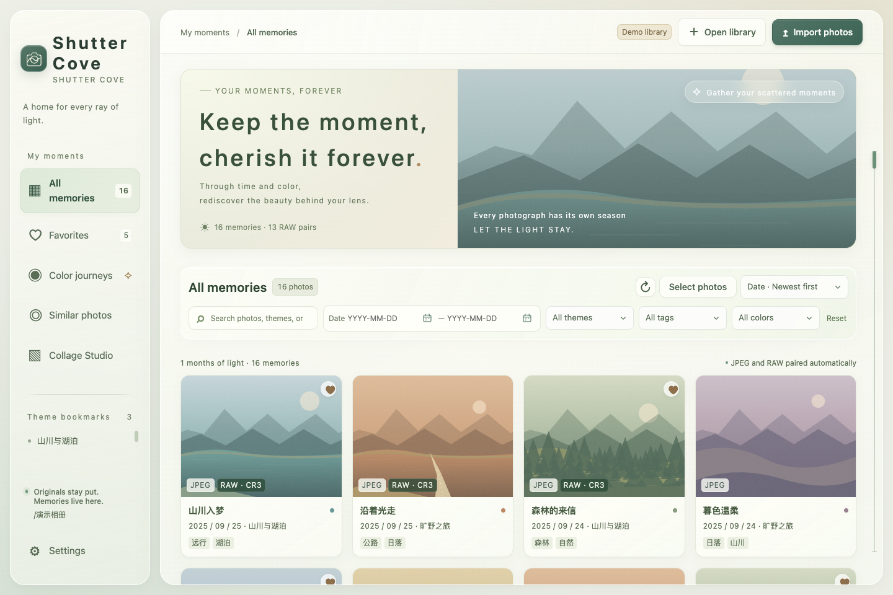

The warm ivory and sage glass interface adds staggered spring entrances, tactile button feedback, and a continuous photo-card-to-detail transition. Animations respect the operating system’s Reduce motion preference. 中文界面采用「时光杂货店」新名字；暖白与鼠尾草绿玻璃界面加入交错入场、按钮轻回弹和照片连续转场，并遵循系统减少动态效果设置。

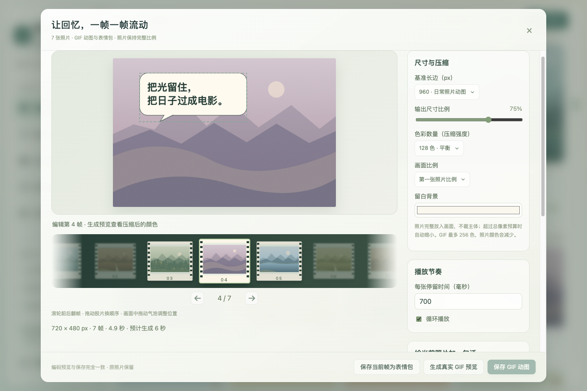

All screenshots use synthetic artwork, with no private photographs, real portraits, personal paths, or real capture metadata. 所有截图使用合成画面，不含私人原片、真人肖像、个人路径或真实拍摄信息。

## インストール

**パッケージ名について：** Shutter Cove は英語ブランド名です。v1.3.0 から中国語名は「时光杂货店」（旧名「拾光屿」）になります。互換性のため、ファイル名は引き続き `Shiguang-Isle-` で始まり、Mac パッケージには `Shiguang Isle.app` が含まれます。同じアプリです。

**公式リポジトリ：** [Undefeated-man/ShutterCove](https://github.com/Undefeated-man/ShutterCove)。v1.2.1 では更新の確認とダウンロードに新しいアドレスを使用します。既存のアプリ識別子、インストール先、お気に入り、タグ、設定は引き継がれます。

[GitHub Releases](https://github.com/Undefeated-man/ShutterCove/releases) から、お使いのコンピューターに合うパッケージをダウンロードしてください。ファイル名は `Shiguang-Isle-` とバージョン番号で始まります。下表はプラットフォームごとの末尾です。

| コンピューター | パッケージ名の末尾 | インストール方法 |
| --- | --- | --- |
| Apple Silicon Mac | `mac-arm64.dmg` | ディスクイメージを開き、アプリを Applications にドラッグ |
| Intel Mac | `mac-x64.dmg` | ディスクイメージを開き、アプリを Applications にドラッグ |
| Linux x64 | `linux-x86_64.AppImage` | 実行権限を付けて起動 |
| Debian / Ubuntu x64 | `linux-amd64.deb` | ソフトウェアインストーラーで開く、または `sudo apt install ./package-name.deb` を実行 |

### macOS での初回起動：Apple がアプリを検証できない場合

**現在の Mac 用パッケージはアドホック署名で、Developer ID 証明書も Apple の公証もありません。そのため、初回起動を Gatekeeper がブロックする場合があります。** Apple がアプリの安全性を確認済みという意味ではありません。

1. このリポジトリの [正式な Release](https://github.com/Undefeated-man/ShutterCove/releases) から、適切なアーキテクチャのパッケージをダウンロードし、**同じバージョン**の `SHA256SUMS.txt` と SHA-256 を照合してください。
2. DMG を開き、**Shiguang Isle.app** を **Applications（アプリケーション）** にドラッグしてください。ZIP 版は展開してから Applications に移動します。
3. インストールしたアプリを一度開いてください。ブロックされた場合は、**システム設定 → プライバシーとセキュリティ → セキュリティ** で該当するメッセージを探し、**「このまま開く」** を選びます。
4. 次の確認画面で **「開く」** を選び、必要に応じて認証してください。macOS がこのアプリの例外を保存するため、以降は通常そのまま起動できます。

ボタンが表示されない場合は Applications 内のアプリをもう一度開いてから設定を確認してください。管理対象の Mac では管理者にお問い合わせください。**「コンピュータに損害を与えます」や「壊れています」** と表示された場合は使用を中断し、改めてダウンロードと照合を行うか、問題を報告してください。これらの警告を一律に公証の不足が原因だと判断しないでください。Gatekeeper は有効のまま、アプリ単位のシステム承認を利用してください。

詳しくは [中国語・英語の Mac インストールガイド](docs/mac-install.md) と [Apple の公式説明](https://support.apple.com/en-us/102445) を参照してください。

一部の Linux ディストリビューションでは AppImage に FUSE 2 が必要です。Photoshop と Lightroom に公式の Linux デスクトップ版はないため、設定でインストール済みのエディターの実行ファイルを指定してください。

Mac 版を手動で更新する場合は、起動中の旧版を終了してから新版を Applications にドラッグし、置き換えてください。Applications から新版を起動します。同じ macOS アカウントとアプリ識別子を使用すれば、既存の設定、タグ、お気に入りを引き続き利用でき、写真を再コピーする必要はありません。更新パッケージも同じバージョンのチェックサムと照合し、macOS が再度承認を求めた場合は上記の手順に従ってください。

v1.0.8 以降は **「相册设置 → 软件更新」（アルバム設定 → ソフトウェア更新）** でバージョンを確認し、手動で更新をチェック・ダウンロードできます。それ以前のバージョンでは、最初に v1.0.8 以降を一度手動でインストールしてください。自動確認は標準で有効ですが、通知のみで、インストールには操作が必要です。Mac / AppImage の **「一键更新并重启」（更新して再起動）** はダウンロードを検証し、既存のインストール先とローカルデータを維持します。Mac は書き込み可能な Applications にインストールする必要があり、ディスクイメージやビルドフォルダー内ではその場で更新できません。AppImage も書き込み可能な場所に置いてください。Linux deb は **「下载并打开安装器」（ダウンロードしてインストーラーを開く）** でシステムのパッケージインストーラーを開き、認証・インストール後はアプリを手動で開き直します。[更新ガイド](docs/updates.md) を参照してください。

## 機能

| 機能 | 使い方・動作 |
| --- | --- |
| 画面の言語 | 英語・簡体字中国語。初回起動時に選択し、設定で即座に切替。再起動後も選択を保存 |
| 初回利用ガイド | 写真ライブラリと撮影後の作業を 5 ステップで紹介。スキップ・完了の状態を保存し、設定から再表示できます |
| 更新確認とインストール | 設定から手動確認、または自動通知。インストール済みの Mac アプリと書き込み可能な AppImage は検証後に同じ場所で更新・再起動し、お気に入り、タグ、設定を維持します |
| 詳細表示の拡大と移動 | Option / Alt を押しながらスクロールして拡大し、ドラッグで移動。「适合窗口」（ウィンドウに合わせる）やダブルクリックで戻し、相対倍率は最大 16 倍です |
| 詳細表示のシステム全画面 | 「全屏」（全画面）または F で切り替え、JPEG / CR3 と前後の写真を表示。Esc はまず全画面を終了し、もう一度押すと詳細を閉じます |
| 色による整理 | 写真の色を自動分析し、日付範囲と組み合わせて閲覧できます |
| 日付・テーマ検索 | カレンダーまたは直接入力で日付を指定し、テーマ名を検索。テーマは 1 枚または選択した複数の写真に手動設定できます |
| 日付タイムライン | 細いバーにポインターを置くか押すと半透明の日付表示が拡大。現在の絞り込み結果全体を日付でたどれます。標準は新しい順です |
| 類似写真検索 | フォルダーを選び、平均プーリングした RGB ピクセルのコサイン類似度を計算。粒度、所要時間の目安、進捗、キャンセルに対応します |
| コラージュとポスター | 縦・横の連結、4 分割、9 分割、余白、フィルム、元の縦横比の雑誌、木製ボード。ポスターは 1 行 1～12 枚（標準 2 枚）、タイトルサイズを設定して新しい JPEG に保存できます |
| 写真ごとの構図調整 | 写真を選び、枠内の倍率と位置、枠を埋めるか全体を収めるかを指定。並べ替えても構図が写真に付いて移動し、キャンバスの拡大とは独立します |
| 共有用の圧縮 | 完成画像の幅と JPEG 品質を設定し、全体の比率と高さを維持。原画像を最終キャンバスに直接描画し、プレビューと保存は同じ符号化データを使います |
| GIF・ミーム作成 | フィルムストリップをスクロールしてフレームを選択し、ドラッグで並べ替え。フレームごとの文字・吹き出し、サイズ、色数、共通の表示時間、ループを設定。実際の GIF プレビューや静止画ミームを保存できます |
| お気に入り | 気に入った写真を登録し、専用の「精品」（お気に入り作品）画面で閲覧できます |
| 個別・一括タグ | 1 枚ずつタグを編集するか、選択した写真にまとめて追加できます |
| 共通の絞り込み | 全写真、お気に入り、色、類似検索結果、コラージュ用の写真選択で日付・色・テーマ・タグを利用できます |
| 固定ツールバー | スクロール中も絞り込み、複数選択、並べ替えが上部に残り、カレンダーやメニューからフォーカスが戻っても位置を維持します |
| すりガラス調メニュー | カレンダーと同じセージグリーン。最大 6 項目を表示し、端を控えめにぼかします。長い一覧は検索可能で、矢印、Enter、Esc に対応します |
| 可変ウィンドウと文字サイズ | ウィンドウを自由に変更。設定の文字サイズスライダーは即座に反映して保存し、標準 120%、範囲 100%～150% です |
| 簡易編集 | 切り抜き、回転、水平・垂直反転、矩形・楕円のピクセルモザイク。JPEG の上書きまたは別名保存ができます |
| SD カード取り込み | 新しい写真を指定の保存先へコピーし、既存または新規のテーマを選択。撮影日で整理し、内容の重複をスキップします |
| 複数選択と削除 | 複数選択、範囲選択、絞り込み結果の全選択に対応し、確認後にシステムのゴミ箱へ移動します |
| 選択写真をフォルダーにコピー | 既存の保存先を選ぶか選択画面で新規フォルダーを作り、異なるサブフォルダーの JPEG を 1 か所に集約。CR3 も任意でコピーできます（標準は無効）。同名衝突時はペア共通の別名を付け、進捗・キャンセル・結果を表示します |
| SD カードへのお気に入り同期 | お気に入りまたは現在の選択から残す写真を確認し、そのほかの JPEG / CR3 を記録付きで復元可能な `待删`（削除待ち）フォルダーへ移動します |

詳細画面では JPEG と対応する CR3 のプレビューを上下に並べ、両形式に Photoshop、Lightroom、システムで開くボタンを用意しています。大きな横位置・縦位置・パノラマ写真も縦横比を維持して枠内に収まり、表示枠の高さはウィンドウに合わせて変わります。詳細画面をスクロールすると下側の CR3 とエディターのボタンが見え、前後の写真への操作は引き続き利用できます。閲覧では軽量なプレビューをキャッシュし、原画像全体のコピーは作りません。

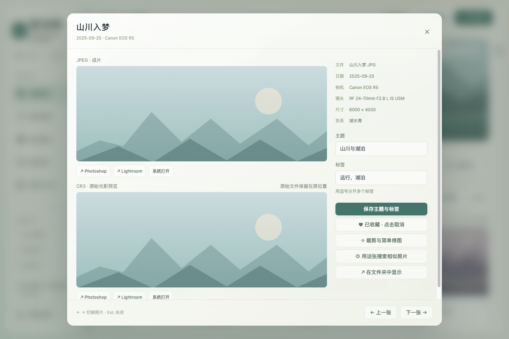

ペア表示の画像は合成写真とサンプル情報で、実在する人物や個人の撮影情報は含みません。

詳細表示では **Option（Mac）/ Alt** を押しながらスクロールして拡大・縮小し、拡大後に画像をドラッグして移動できます。通常のスクロールは詳細画面の移動に使います。「适合窗口」（ウィンドウに合わせる）または画像のダブルクリックで元に戻します。プレビューにフォーカスがあるときは + / − で拡大・縮小、0 でリセットできます。**100% はウィンドウに収めた状態を基準にした倍率で、原画像のピクセル等倍ではありません。** 最大はその 16 倍です。JPEG と CR3 は個別に拡大でき、写真の切り替えや表示領域のサイズ変更で全体表示に戻ります。CR3 は RAW 現像ではなくカメラ内蔵プレビューを拡大するため、解像感はそのプレビューの解像度に左右されます。

プレビュー脇の「全屏」（全画面）または **F** で OS の全画面表示に入ります。JPEG / CR3 を切り替え、← / → で前後の写真を表示し、拡大・移動も続けられます。**Esc** はまず詳細画面に戻り、もう一度押すと詳細を閉じます。閉じると、詳細を開く前の全画面状態に戻ります。

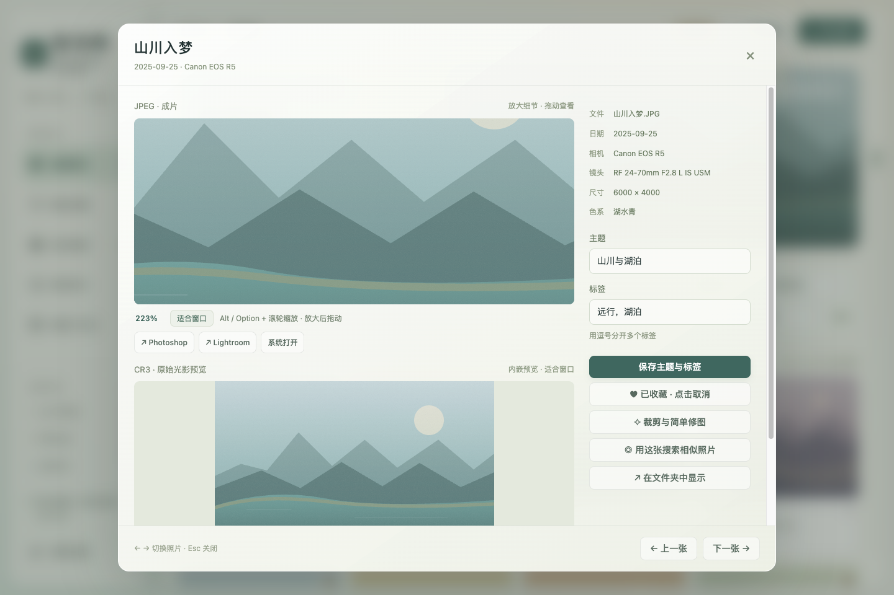

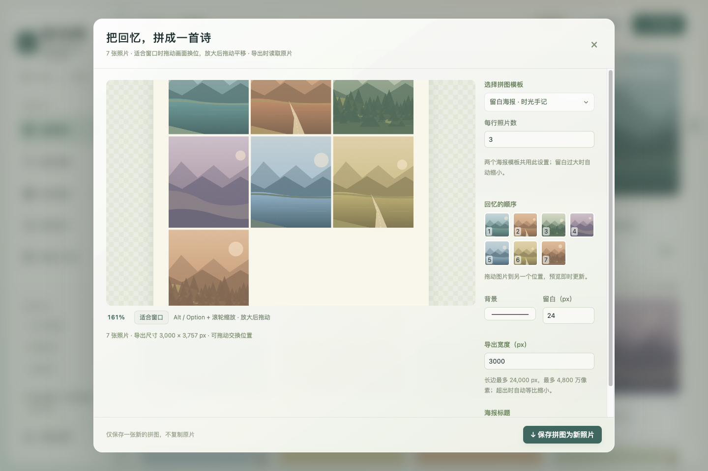

「调整构图」（構図を調整）を選び、写真をクリックしてから枠内をドラッグしたり倍率を変えたりします。「完整放入格子」（枠に全体を収める）を選ぶと写真全体を表示できます。サムネイルを並べ替えても構図設定は写真に付いて移動します。Alt / Option + スクロールはキャンバス全体の拡大で、拡大中は通常のドラッグでキャンバスを移動し、**Shift + ドラッグ** で選択中の写真を調整します。

「原比例海报 · 光影杂志」（元の縦横比の雑誌ポスター）は写真全体と元の比率を保ち、独立したタイトル欄を配置します。「木质展示板 · 贴住回忆」（木製の思い出ボード）では、写真全体の位置・サイズ・角度・重なり順を変更でき、重ねて配置できます。タイトルサイズは書き出し幅でのピクセル値を指定し、出力を縮小する場合は一緒に縮小します。

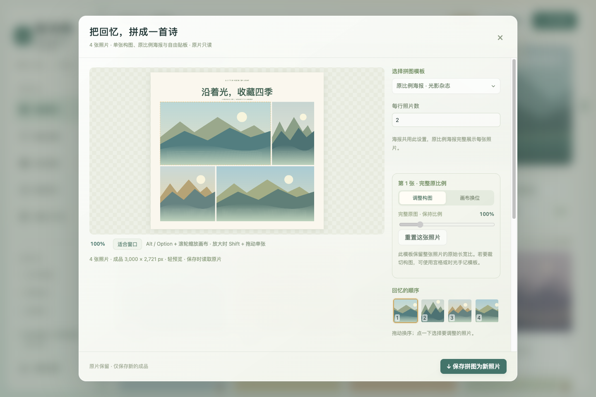

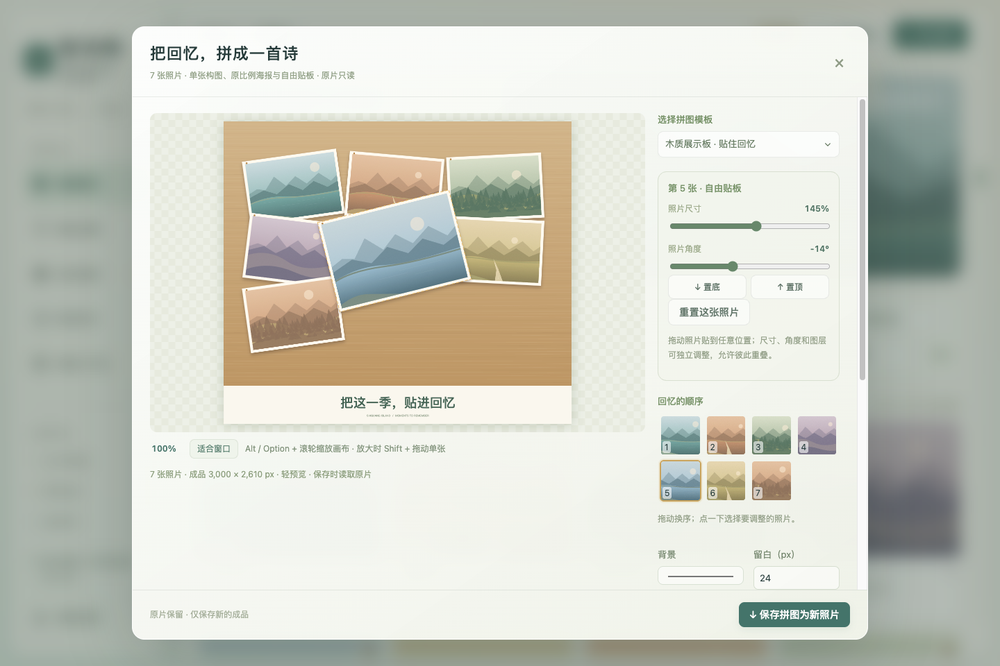

「主动压缩图片大小 · 分享预览」（共有用に画像を圧縮・プレビュー）を有効にし、**完成画像の幅**と JPEG 品質を指定します。幅は標準 **1,440 px**、高精細設定 **2,560 px**、カスタム **480～8,000 px** で、非圧縮時の出力幅を超えて拡大しません。全体を比例縮小して縦方向の内容をすべて保ち、画像を引き伸ばしません。例えば 3000 × 8364 の配置は幅 1440 なら約 1440 × 4015 となり、長辺 1440 による 516 × 1440 の細い画像を避けます。各辺 24,000 px・4,800 万画素の上限を超える場合はさらに比例縮小し、実際の寸法を表示します。原画像を最終キャンバスに直接描画して JPEG を一度だけ符号化し、写真ごとの事前縮小を省きます。プレビューと保存は同じ JPEG データを使い、変更時に再生成します。原画像は維持し、写真フォルダーに中間コピーを残しません。匿名サンプル **3000 × 8364 → 516 × 1440** は WeChat 共通の処理規則を示すものではありません。画素数を多く保てば細部を残しやすくなりますが、再圧縮の回避は保証されません。「見たとおりに保存」は本アプリの出力ファイルを指します。

JPEG 品質の標準値は **90%** です。共有プレビューは「**适合宽度 / Fit to width**」（幅に合わせる）で開始し、通常のスクロールで縦長の完成画像を閲覧できます。「适合窗口 / Fit to window」で全体を確認し、「适合宽度」で幅表示に戻れます。Alt / Option + スクロールによる拡大も使えます。

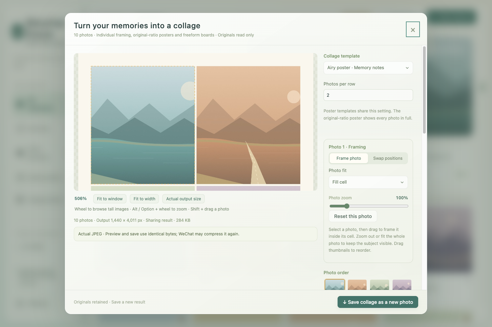

JPEG のある写真を選び、「GIF / 表情包」（GIF・ミーム作成）を開きます。フィルムストリップをスクロールして閲覧し、サムネイルをドラッグして並べ替え、現在のフレームに文字や吹き出しを追加・移動できます。出力倍率、色数、全フレーム共通の表示時間、ループを設定して実際の GIF を生成・プレビューし、その完成画像を保存します。1 枚の写真から静止画ミームも作れます。CR3 しかない写真は先に JPEG に書き出してください。符号化には進捗とキャンセルがあり、GIF は最大 256 色のため写真のグラデーションに色の段差が出る場合があります。


[中国語・英語のクリエイティブスタジオガイド](docs/creative-studio.md) も参照してください。これらの作成画面は合成写真で、実在する人物や個人情報を含みません。

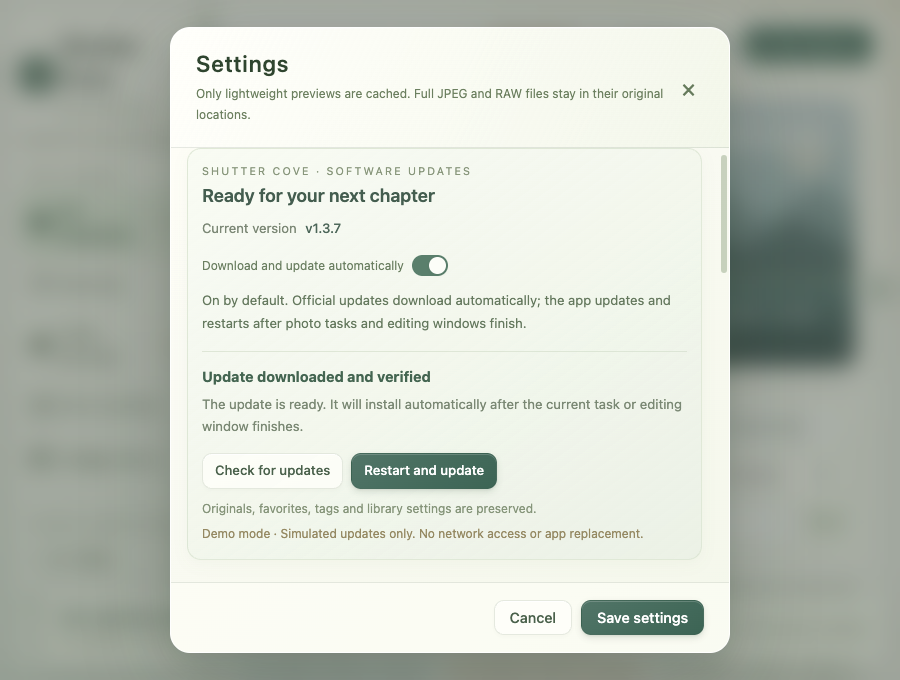

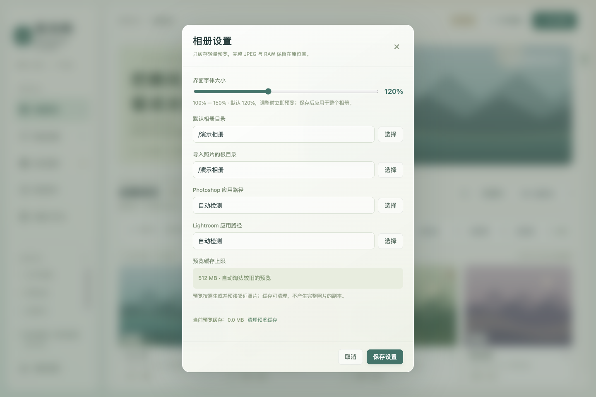

日付はカレンダーで選択するか直接入力できます。細いタイムラインは半透明の日付表示を拡大し、現在の絞り込み結果をすばやくたどれます。

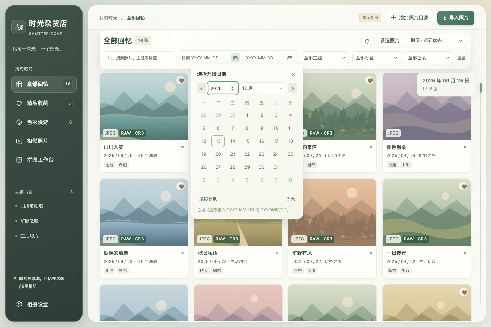

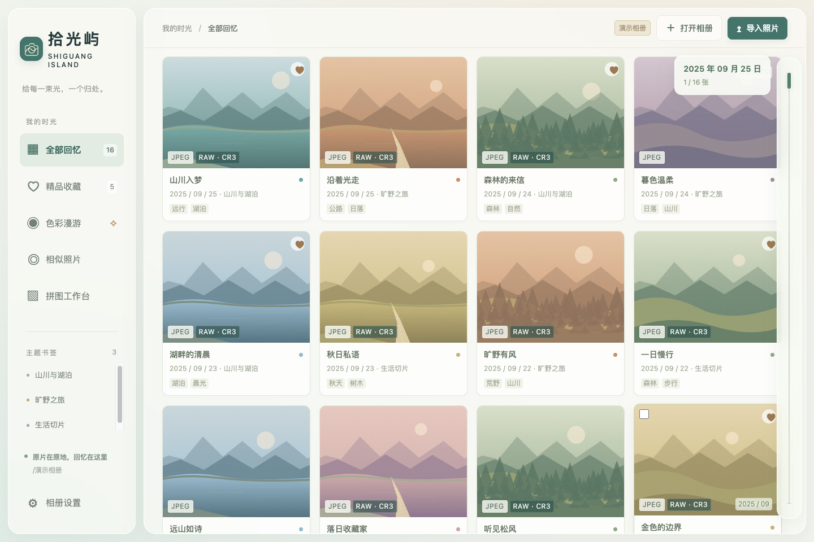

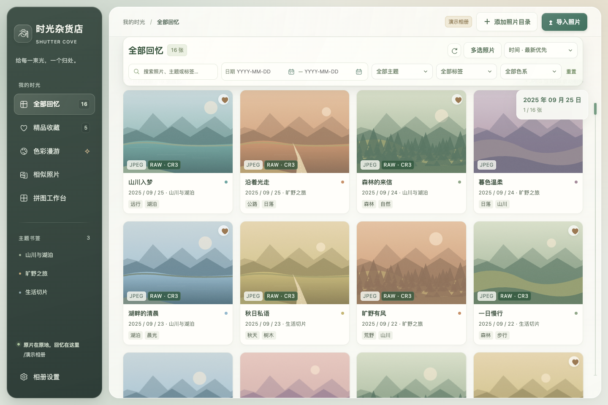

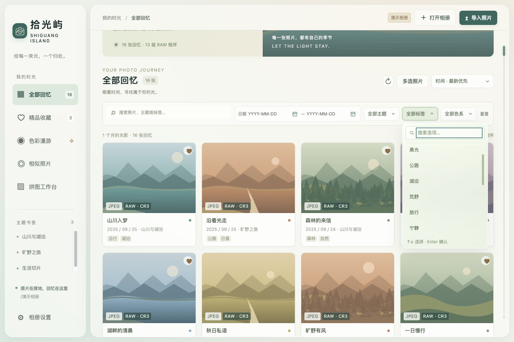

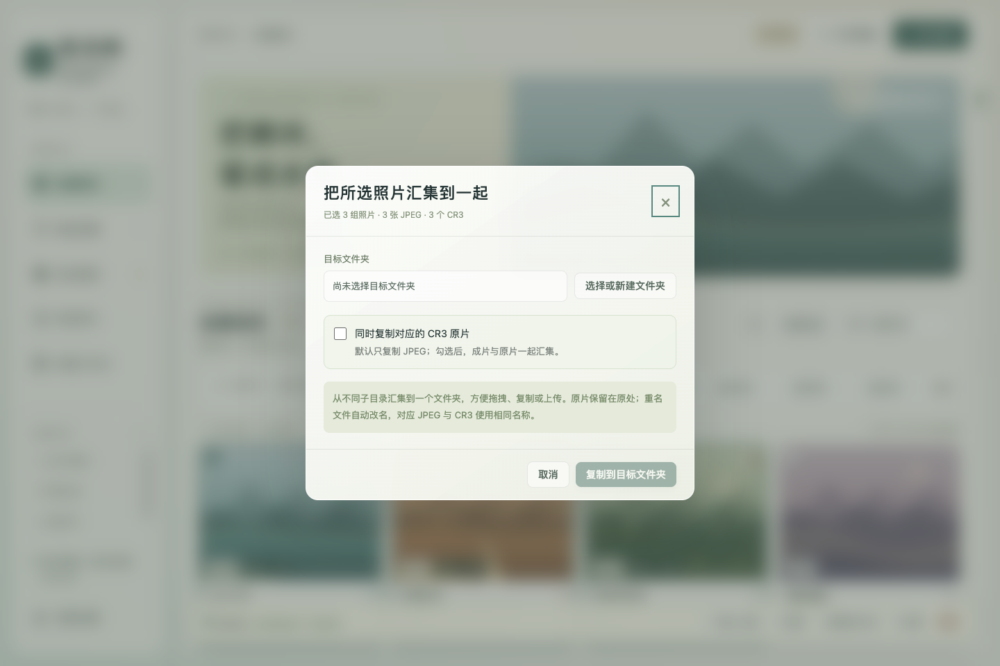

SD カードのお気に入り同期は、確認前に残すファイルと移動するファイルを表示します。それ以外の写真は復元可能な `待删`（削除待ち）フォルダーへ移動します。この画像は合成の確認画面のみで、移動は実行しておらず、実際の SD カードにもアクセスしていません。

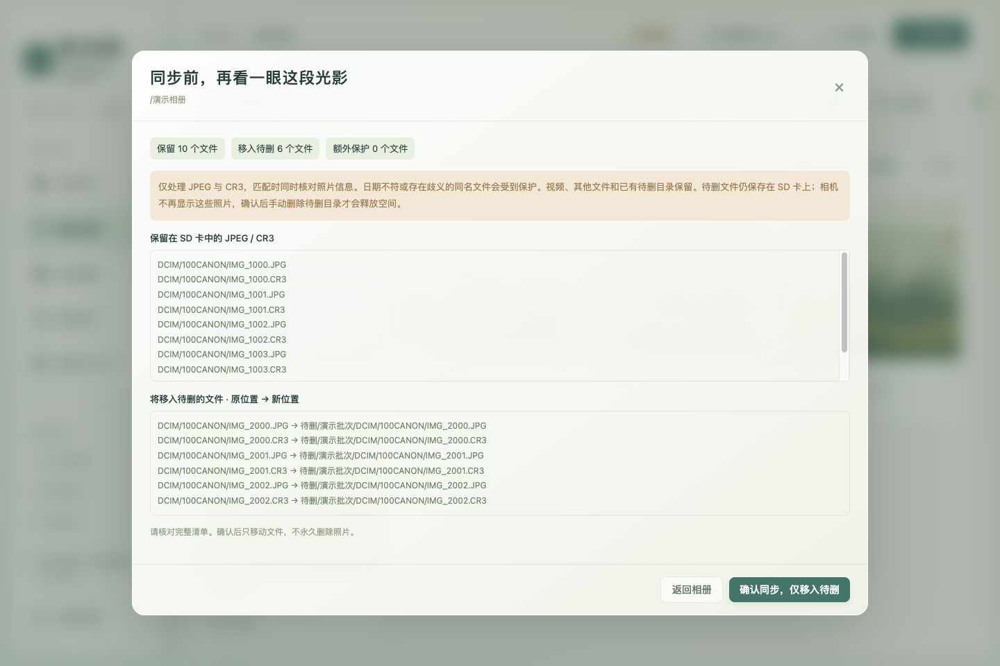

これらのスクリーンショットは合成写真で、実在する人物、個人のパス、実際の撮影情報を含みません。

## ライブラリの使い方

最初の通常起動では、ローカル JPEG / CR3 ライブラリ、フォルダーを開く・SD から取り込む、絞り込み・お気に入り・タグ、編集・共有、確認してから実行する SD カード整理を紹介する 5 ステップのガイドが表示されます。← / → で移動できます。スキップまたは完了すると状態を保存し、次回以降は自動表示しません。保存が失敗した場合は再試行できます。

「开始浏览」（閲覧を開始）でガイドを閉じるか、「选择照片文件夹」（写真フォルダーを選択）でフォルダー選択を開きます。ガイドは操作を説明するだけで、自動的に写真を整理しません。ライブラリ設定済みの利用者には更新時に自動表示されません。**「相册设置 → 重新查看使用引导」（アルバム設定 → 利用ガイドをもう一度見る）** から再表示できます。

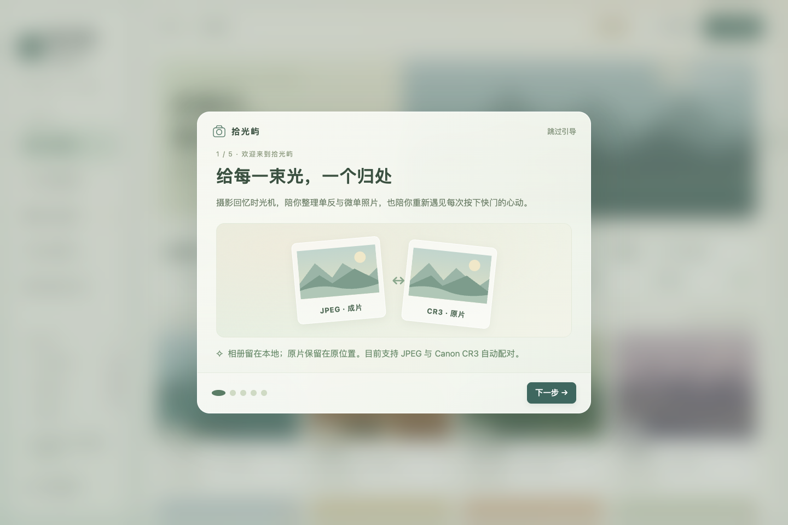

1. 写真のルートフォルダーを選びます。サブフォルダーも走査し、名前・日付・フォルダーの関係から JPEG / CR3 のペアを識別します。元のファイルの場所は維持します。
2. 日付範囲・色・タグ・テーマで絞り込みます。日付はカレンダーまたは直接入力で指定します。細い日付バーをたどると絞り込み結果全体を移動でき、ポインターを置くか押すと半透明の日付が拡大します。標準は新しい順です。お気に入り画面では選んだ作品をまとめて見られます。
3. 複数選択してタグ追加、お気に入り登録、フォルダーへのコピー、ゴミ箱への移動ができます。「复制到文件夹」（フォルダーにコピー）は異なるサブフォルダーの写真を集める操作で、既存の保存先を選ぶか、選択画面で新規フォルダーを作れます。標準は JPEG のみで、対応する CR3 も含められます。原画像は維持し、同名衝突には JPEG / CR3 ペア共通の別名を付けます。進捗、成功・スキップ・失敗の結果を確認でき、キャンセルも可能です。RAW のみの写真は CR3 コピーを有効にしない限りスキップします。1 枚なら引き続きファイルマネージャーで表示したり、JPEG / CR3 をエディターに渡したりできます。
4. 類似写真検索を開き、基準の写真と検索フォルダー、プーリングの粒度を選びます。計算はその検索時に行い、所要時間の目安と進捗を表示します。結果は日付などの共通条件でさらに絞れます。
5. コラージュ画面でレイアウトを選び、写真ごとに構図を調整します。余白・フィルム・元の縦横比の雑誌ポスターは 1 行 1～12 枚（標準 2 枚）を指定できます。木製ボードでは写真の位置・角度・重なり順を変更できます。サムネイルをドラッグして並べ替えるか、「画布换位」（キャンバス上で入れ替え）で写真を直接交換します。Alt / Option + スクロールでプレビューを拡大し、通常のドラッグでキャンバスを移動、Shift + ドラッグで写真を調整します。「适合窗口」（ウィンドウに合わせる）で戻ります。共有用の圧縮を有効にした場合は、実際の JPEG 完成画像を確認して新しい写真として保存します。
6. エディターで切り抜き・回転・反転・矩形や楕円のモザイクを行い、上書きまたは別名保存を選びます。キャンバスからの書き出しは元の EXIF を保持せず、CR3 を上書き編集しません。
7. SD カードや別のフォルダーから、指定した思い出の保存先に取り込みます。既存のテーマか新しいテーマを選びます。ファイルをコピーし、撮影日で整理して重複を確認します。元のファイルは残ります。
8. お気に入りまたは現在の選択を SD カードに同期します。まず残すファイルと移動するファイルを確認します。それ以外の JPEG / CR3 は、相対パスと操作記録を維持してカード内の `待删`（削除待ち）フォルダーに移動します。該当写真がない場合、照合が曖昧な場合、確認後にファイルが変わった場合は実行を停止します。
9. JPEG のある写真を選んで「GIF / 表情包」（GIF・ミーム作成）を開きます。スクロールでフレームを見て、ドラッグで順序を変え、フレームごとに文字を追加します。符号化したプレビューを生成して GIF を保存するか、現在のフレームを静止画ミームとして保存します。

`待删` への移動は内容を維持するため、カードの空き容量はすぐには増えません。その回のフォルダーを開いて確認するか、記録された元の場所へ復元できます。不要だと確認できた時点で、削除待ちファイルを自分で削除してください。

テーマとタグは手動で設定するローカル情報です。色の分類は画像のピクセルから算出し、暖色・青・緑などの色調を探すためのもので、場所や写真の物語を判別するものではありません。

絞り込みと並べ替えのメニューはマウス・キーボードに対応します。長い一覧は最大 6 項目を表示し、スクロールや検索ができます。↑ / ↓ で移動、Enter で確定、Esc で閉じます。端の控えめなぼかしは、さらにスクロールできる項目を示します。

CR3 の表示は完全な RAW 現像ではなく、カメラが保存した内蔵プレビューです。Photoshop は通常 Adobe Camera Raw に RAW 処理を渡します。Lightroom はバージョンによって取り込み画面を開く場合がありますが、时光杂货店はファイルを渡すだけで、Adobe のカタログへの取り込みを自動完了しません。

縦・横のコラージュには固定の写真枚数制限はありません。メモリー使用量を抑えるため、キャンバスは **長辺 24,000 px、総画素数 4,800 万** が上限で、超える場合は比率を保って縮小します。非常に大きい原画像の簡易編集にも同じ制限があります。それを超えるフル解像度の現像には専門エディターを使用してください。

GIF は **2～80 フレーム**、各辺 **最大 1,600 px**、全フレーム合計 **2,400 万画素**、符号化データ **最大 24 MB** に対応します。画面は画素数の上限に合わせてサイズを縮小し、残る制限超過はエラーとして表示します。1 枚の写真は静止画ミームとして保存できます。これらの資源上限は、他のアプリの送信制限を表すものではありません。

写真をスクロールしても絞り込み・選択・並べ替えツールバーは上部に残るため、先頭に戻らず条件・順序・選択写真の操作を変更できます。高さはウィンドウと文字サイズに合わせて変化し、写真への移動ではその下の空間を確保します。カレンダーやメニューの開閉・確定後にフォーカスが戻っても、スクロール位置を維持します。

## 速度と保存領域

サムネイルは必要に応じて生成し、表示中と付近の写真を優先します。走査中は読み取れた写真から順次表示し、次回の走査ではファイル情報のキャッシュを再利用します。RAW は可能な場合に内蔵プレビューを使います。プレビューのキャッシュ上限は **512 MB** で、最近使っていない項目から削除し、手動でも消去できます。閲覧のために原画像と同じ解像度のコピーを作ることはありません。

記録、お気に入り、タグ、テーマ、設定、消去可能なプレビューは OS のアプリデータ領域（Electron の `userData`）に保存します。大きなライブラリの初回走査ではファイル情報の読み取りが必要です。壊れた RAW、オフラインの RAW、内蔵プレビューのない RAW はエラーを表示する場合がありますが、他の写真は引き続き利用できます。

上書き編集、コラージュ出力、一括コピー、SD 取り込みは選択に従ってファイルを作成・変更します。一括コピーは原画像を移動せず、キャンセルした場合も完了済みのコピーは残ります。一括削除は件数と確認を表示してからシステムのゴミ箱へ移動します。権限不足、ドライブの取り外し、容量不足は操作エラーとして表示します。

## 開発とビルド

Node.js 22、npm、macOS または Linux が必要です。Linux の ExifTool にはシステムの Perl が必要で、macOS には Perl が含まれています。

```sh
npm ci
npm test
npm run privacy
npm run icon
npm start
```

合成画像のデモを起動：

```sh
npm run demo
```

インストールパッケージをビルド：

```sh
# 対応するアーキテクチャの Mac 上でビルド
npm run build:mac
# Linux x64 上でビルド
npm run build:linux
```

出力先は `dist/` です。GitHub Actions は macOS 15 arm64、macOS 15 Intel、Ubuntu 22.04 x64 でそれぞれビルドし、パッケージ化したアプリを起動します。合成のテストデータで、写真ライブラリ、コラージュ上限、SD 画面、文字設定、日付入力、タイムライン、メニュー、一括コピー画面と実際のディスクコピー、本番 IPC、ディスクへの書き出し、復元可能な SD 同期を検証します。すべて成功すると、パッケージとチェックサムを含む下書き Release を作成します。`package.json` と同じバージョンの `v` タグをプッシュすると実行でき、既存タグを指定して手動実行もできます。下書きを確認してから公開してください。

## プライバシーとライセンス

アプリにはアカウント、テレメトリー、写真アップロード、オンライン写真分析の機能はありません。更新確認はこのプロジェクトの GitHub Releases とパッケージ配信先にのみ接続し、写真・タグ・ライブラリのパスを送信しません。自動確認は設定で無効にできます。公開リポジトリにはソースコード、アイコン、合成スクリーンショットを含めます。`npm run privacy` は原メディア、実行時データベース、個人の絶対パス、一般的な秘密情報の形式を確認します。スクリーンショットの内容は目視確認も必要です。

アプリのソースコードは [MIT License](LICENSE) です。Electron、Sharp、ExifTool などの依存関係はそれぞれのライセンスに従います。ExifTool は Phil Harvey によるソフトウェアで、Perl と同じデュアルライセンスです。[アーキテクチャと第三者ライセンス](docs/architecture.md) を参照してください。

実際の検証内容と制限は [検証記録](docs/validation.md) に記載しています。
