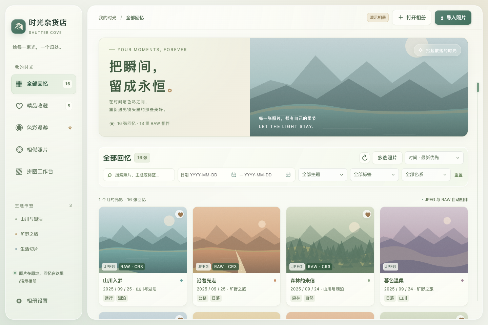

# Shutter Cove: RAW Photo Organizer & Creative Studio

**Language:** [English](README.md) · [简体中文](README.zh-CN.md) · [日本語](README.ja.md) · [한국어](README.ko.md)

**时光杂货店：专为 RAW 摄影打造的整理与创作相册 — 精选照片，制作拼图海报与 GIF 动图。**

## English

**A local desktop photo library built specifically for DSLR and mirrorless photographers who shoot RAW.**

Shutter Cove (时光杂货店) follows your photography workflow: import from an SD card, browse RAW / JPEG pairs, select your best shots, hand files to an editor, and turn photographs into posters or animated stories. Available for macOS and Linux. **Currently supports JPEG and Canon CR3; RAW support is limited to CR3.**

- **Keep RAW and JPEG together.** Browse matching files as a pair, inspect details with zoom and fullscreen, and open either format in Photoshop / Lightroom on Mac or a configured local editor on Linux.
- **Browse quickly without duplicating originals.** On-demand thumbnails, nearby-photo prefetching, and a bounded, removable preview cache keep the library light while originals stay in their folders.
- **Find and curate your best photographs.** Filter by date, color, theme, and tags; collect favorites, tag in batches, and search similar photographs on demand without building a vector database first.
- **Make collages and posters with control over composition.** Zoom and move each photograph within its cell, preserve original aspect ratios in a magazine poster, or freely position, resize, rotate, and overlap full photographs on a wooden board. Set title size, customize background and text colors, arrange the story, and preview the actual encoded share JPEG before saving the same result.
- **Create GIF stories and memes.** Scroll a filmstrip, drag frames to reorder, and add movable speech bubbles or text to each photograph. Choose output scale, palette, frame timing, and looping; preview a real encoded GIF, or save one frame as a static PNG meme.
- **Organize from SD card to delivery.** Import by capture date and gather selections across folders into one destination, optionally including CR3. Favorite synchronization first moves other JPEG / CR3 files on the chosen SD card into a recoverable pending-deletion folder for review.

*Give every captured moment a small island to return to.*

## 简体中文

**专为拍摄 RAW 的单反与微单摄影用户量身定制的本地桌面相册。**

时光杂货店围绕相机摄影的完整流程设计：从 SD 卡导入、RAW / JPEG 配对浏览、精选整理和修图交接，到拼图海报与光影动图，让照片更容易找、选、用。支持 macOS 与 Linux；**当前支持 JPEG 与 Canon CR3，RAW 支持目前限于 CR3。**

- **一张照片，RAW / JPEG 一起管理。** 配对浏览、放大查看细节与全屏看图；Mac 可交给 Photoshop / Lightroom，Linux 可配置本机编辑器。
- **轻量预览，减少等待和存储负担。** 缩略图按需加载、预读，缓存有上限且可清理；原片留在原目录，浏览不额外复制完整照片。
- **从一堆照片中找出值得留下的作品。** 按日期、色系、主题和标签筛选，收藏精品、批量加标签；相似照片按需计算，无需预先建立向量库。
- **拼图与海报，让每张照片都有合适的构图。** 单张缩放、拖动格内位置；杂志海报保留原比例，木质展示板可自由移动、调大小、旋转和叠放完整照片。标题字号、背景色与文字颜色可调，分享压缩展示实际编码成品，预览与保存一致。
- **GIF 与表情包，让回忆一帧一帧流动。** 滚轮浏览电影胶片、拖拽换序，逐帧添加可移动的对话气泡与文字；设置尺寸、色彩数、时长和循环，预览真实 GIF，也可保存单帧 PNG 表情包。
- **从 SD 卡整理到作品交付。** 新照片按拍摄日期归档，跨目录选片后一键复制，可选携带 CR3；精品同步先将 SD 卡里其他 JPEG / CR3 移入可恢复的待删文件夹，方便核对。

*把一次快门，留成一座可以重返的小岛。*

**The app supports English and Simplified Chinese.** A fresh installation starts in English and asks you to choose a language before the usage guide. Existing Chinese profiles stay in Chinese after an upgrade. Switch instantly in **Settings → Interface language**; your choice is remembered. Japanese and Korean guides are documentation translations; their interface languages may be added according to demand.

**App 当前支持英文与简体中文。** 全新安装默认英文，首次打开先选择语言，再进入使用引导；已有中文用户升级后保留中文。在**设置 → 界面语言**可一键切换并记住选择。日文和韩文页面为使用说明翻译，后续根据需求增加界面语言。



The warm ivory and sage glass interface adds staggered spring entrances, tactile button feedback, and a continuous photo-card-to-detail transition. Animations respect the operating system’s Reduce motion preference. 中文界面采用「时光杂货店」新名字；暖白与鼠尾草绿玻璃界面加入交错入场、按钮轻回弹和照片连续转场，并遵循系统减少动态效果设置。


All screenshots use synthetic artwork, with no private photographs, real portraits, personal paths, or real capture metadata. 所有截图使用合成画面，不含私人原片、真人肖像、个人路径或真实拍摄信息。

## 安装

**安装包名称：** Shutter Cove 是英文品牌名；v1.3.6 起中文名称为「时光杂货店」（原名「拾光屿」）。为兼容已有安装，文件名前缀仍为 `Shiguang-Isle-`，Mac 包内仍为 `Shiguang Isle.app`；这是同一个应用，下载时认准本仓库的正式发布页。

**官方仓库：** [Undefeated-man/ShutterCove](https://github.com/Undefeated-man/ShutterCove)。v1.2.1 的更新检查与下载已使用新地址；已有应用保留原应用标识、安装路径、收藏、标签和设置。

在 [GitHub Releases](https://github.com/Undefeated-man/ShutterCove/releases) 下载与你的电脑匹配的安装包。

| 电脑 | 文件 | 安装方式 |
| --- | --- | --- |
| Apple Silicon Mac | `mac-arm64.dmg` | 打开后拖进 Applications |
| Intel Mac | `mac-x64.dmg` | 打开后拖进 Applications |
| Linux x64 | `linux-x86_64.AppImage` | 添加可执行权限后运行 |
| Debian / Ubuntu x64 | `linux-amd64.deb` | 用软件安装器打开，或 `sudo apt install ./文件名.deb` |

### macOS 首次打开：Apple 无法确认安全性

**当前 Mac 包使用 ad-hoc 签名，没有 Developer ID 证书，也未经过 Apple 公证，因此首次启动可能被 Gatekeeper 阻止。** 这不等于 Apple 已确认软件安全。

1. 从本仓库的 [正式 Release](https://github.com/Undefeated-man/ShutterCove/releases) 下载匹配架构的包，并与**同一版本**的 `SHA256SUMS.txt` 核对 SHA-256。
2. 打开 DMG，将 **Shiguang Isle.app** 拖入 **Applications（应用程序）**；ZIP 包先解压，再移入应用程序。
3. 尝试打开已安装的 App 一次。被阻止后，进入 **系统设置 → 隐私与安全性 → 安全性**，找到它的提示并点 **“仍要打开”**。
4. 在再次出现的提示中点 **“打开”**，按需认证。系统会为这个 App 保存例外，以后通常可直接打开。

没有“仍要打开”按钮时，重新尝试打开 Applications 中的 App，再查看该设置；受管理的电脑请联系管理员。如果提示**“将损坏你的电脑”或“已损坏”**，先停止使用，重新下载并核验，或向项目报告；不同提示不能一律归因于未公证。保持 Gatekeeper 开启，使用单个 App 的系统允许流程。

详见 [中英文 Mac 安装指南](docs/mac-install.md) 与 [Apple 官方说明](https://support.apple.com/zh-cn/102445)。

Linux AppImage 在部分发行版需要 FUSE 2。Photoshop / Lightroom 没有官方 Linux 桌面版；在设置里指定本机安装的编辑器即可交接文件。

更新 Mac 版时，先退出正在运行的旧版，再将新版 App 拖入 Applications 并选择替换，从 Applications 启动新版。保持使用同一个 macOS 用户及相同应用标识，原有相册设置、标签与收藏会继续使用本机的应用资料，不需要重新复制照片。更新包同样应核对同版校验表，系统提示需要时按上面的单应用允许流程操作。

从 v1.0.8 起，可在 **相册设置 → 软件更新** 查看当前版本、手动检查或下载更新；更早版本需先手动安装 v1.0.8 或更新版本一次。默认自动检查新版，仅提醒、不自动安装。Mac / AppImage 可点击“一键更新并重启”，下载校验后沿用原安装位置及本机资料。Mac 需安装在可写的 Applications，不能直接在 DMG 或构建目录中原位更新；AppImage 需位于可写位置。Linux deb 使用“下载并打开安装器”，由系统完成认证与安装，之后手动重新打开应用。详见 [更新说明](docs/updates.md)。

## 功能

| 功能 | 支持方式 |
| --- | --- |
| 界面语言 | 简体中文 / English；首次打开先选语言，设置里一键切换，重启后记住选择 |
| 首次使用引导 | 五步介绍相册、选片与整理；跳过或完成后保存状态，可在设置中重新查看 |
| 检查与安装更新 | 设置里手动检查，默认自动检查并提醒；Mac 正式安装与可写 AppImage 支持下载校验后原位替换及重启，保留收藏、标签和设置 |
| 详情缩放与平移 | 按住 Option / Alt 滚轮缩放，放大后拖拽查看；点“适合窗口”或双击复位，最大 16 倍相对缩放 |
| 详情系统全屏 | 点击“全屏”或按 F 进入系统全屏，切换 JPEG / CR3 预览并左右看图；Esc 先退出全屏，再次按下关闭详情 |
| 色系整理 | 自动分析画面颜色，并结合日期区间浏览 |
| 日期与主题搜索 | 点击日历或直接输入日期来限制区间、搜索主题名称；主题可为单张或多张照片手动设置 |
| 日期时间轴 | 纤细时间轴悬停或按住时展开半透明日期提示，拖动快速跳到当前全部筛选结果中的相应日期；默认按日期倒序浏览 |
| 相似照片 | 选择目录，按不同粒度的像素平均池化计算余弦相似度；按需计算，带时间估计、进度与取消 |
| 拼图与海报 | 上下、左右、四宫格、九宫格、留白、胶片、原比例杂志与木质展示板；海报每行张数可设 1–12，默认 2，标题字号可调整，存为新 JPEG |
| 单张拼图构图 | 点选照片，调整格内缩放与位置，选择填满或完整放入；构图随照片换序保留，画布缩放独立控制 |
| 主动分享压缩 | 按最终成图宽度和 JPEG 品质控制大小，整幅排版等比缩放并保留完整高度；原片直接绘制到成品画布，预览与保存使用同一份编码字节，原片保留 |
| GIF 与表情包 | 胶片滚轮选帧、拖拽换序，每帧可加文字或气泡；设置尺寸、色彩数、统一帧时长与循环，预览真实编码 GIF，或保存单帧表情包 |
| 精品收藏 | 收藏喜欢的照片，在精品视图中单独浏览 |
| 单张与批量标签 | 每张照片可单独设置，也可多选后一键添加 |
| 全局筛选 | 全部、精品、色彩、相似和拼图选片视图共用日期、色系、主题与标签条件 |
| 固定图库工具栏 | 滚动照片时，筛选、多选与排序栏保持在顶部；日历和菜单交互后返回焦点时保持当前位置 |
| 毛玻璃下拉菜单 | 与日历统一的鼠尾草绿样式，最多显示六项，滚动边缘轻微渐隐；长列表可搜索，支持方向键选择、Enter 确认与 Esc 关闭 |
| 自适应窗口与字号 | 窗口可以调整大小；设置中的字号滑块即时预览并持久保存，默认 120%，可在 100%–150% 间调整 |
| 简单修图 | 裁剪、旋转、水平 / 垂直镜像、矩形 / 椭圆马赛克；覆盖 JPEG 或另存为 |
| SD 卡导入 | 复制新照片到指定回忆根目录，选择已有或新主题，按拍摄日期归档并跳过重复内容 |
| 批量选择与删除 | 多选、范围选取与筛选结果全选；确认后移入系统废纸篓 |
| 批量复制到文件夹 | 选择已有或新建目标文件夹，跨子目录平铺汇集 JPEG，可勾选同时复制 CR3（默认关闭）；重名自动唯一改名，JPEG / CR3 共用名称，带进度、取消与结果 |
| SD 卡精品同步 | 预览精品或当前选择的保留清单，其余 JPEG / CR3 移入可恢复的 `待删` 批次并保存操作记录 |

JPEG 与对应 CR3 在同一个详情视图中上下配对显示，两种文件均提供 Photoshop、Lightroom 和系统打开按钮。大尺寸横图、竖图及宽幅图按比例完整适配预览框，预览区随窗口高度调整；详情可滚动查看下方 CR3 预览及编辑器按钮，上一张 / 下一张按钮始终可用。缩略图按需缓存和预读，浏览不复制完整原片。


双预览截图使用合成照片和示例资料，不含真人或私人拍摄信息。

查看详情时，按住 **Option（Mac）/ Alt** 使用滚轮放大或缩小，放大后按住图片拖拽平移；普通滚轮仍用于滚动详情。点击“适合窗口”或双击图片恢复整张适配；预览获得焦点时可按 + / − 缩放、按 0 复位。**100% 表示相对于适合窗口大小的缩放，并非原图像素 1:1**；最大为适合窗口大小的 16 倍。JPEG 与 CR3 预览独立缩放，切换照片或调整预览区域大小时恢复适配。CR3 缩放的是相机内嵌预览，不是 RAW 显影，预览清晰度取决于内嵌图像。

点击预览旁的“全屏”或按 **F**，进入系统全屏看图；可切换 JPEG / CR3 预览、按 ← / → 看相邻照片，并继续缩放和平移。**Esc** 先返回详情，再按一次关闭详情；关闭详情恢复进入前的窗口全屏状态。


“调整构图”用于单张照片：先点选，再拖动格内画面、调整缩放，或选择“完整放入格子”。缩略图拖拽换序时，构图跟着照片移动。Alt / Option + 滚轮控制整个画布预览；放大画布后，普通拖动平移画布，**Shift + 拖动**调整所选照片。

“原比例海报 · 光影杂志”完整保留每张照片的比例，标题有独立区域。“木质展示板 · 贴住回忆”可拖动整张照片、调整尺寸和角度、置顶或置底并叠放。标题字号按导出宽度下的像素设置，成品缩小时一同缩放。


打开“主动压缩图片大小 · 分享预览”，设置**最终成图宽度**和 JPEG 品质。宽度默认 **1,440 px**，清晰档为 **2,560 px**，自定义支持 **480–8,000 px**，不会放大超过未压缩的导出宽度。整幅排版等比缩放，保留完整纵向内容，不拉伸形变：例如 3000 × 8364 的成图按宽度 1440 缩为约 1440 × 4015，不再按高度 1440 缩成 516 × 1440 的窄图。仍遵守每边 24,000 px 和 4,800 万像素限制，必要时继续等比缩小，并提示实际尺寸。原片直接绘制到最终尺寸画布，再进行一次 JPEG 编码，减少逐张预缩小的额外采样；预览与保存使用同一份字节。修改构图或布局后重新生成，处理不覆盖原片、不留下中间副本。匿名 **3000 × 8364 → 516 × 1440** 样本不代表微信的固定规则；保留更多成品像素有助于保留细节，但不能保证免于再次压缩。这里的所见即所得针对本应用导出的文件。

JPEG 品质默认 **90%**。“最终宽度（px）”控制导出，分享预览默认“**适合宽度**”，普通滚轮上下浏览完整长图；点击“适合窗口”总览，点击“适合宽度”恢复宽度展示，Alt / Option + 滚轮继续放大细节。


多选带 JPEG 的照片，打开“GIF / 表情包”：滚轮浏览胶片，拖动缩略图换序，为当前帧添加并拖动文字或气泡。设置尺寸比例、色彩数、统一帧时长与循环后，生成真实 GIF 预览再保存同一份成品；单张也可保存为静态表情包。仅有 CR3 的照片需先导出 JPEG。编码提供进度与取消，GIF 最多 256 色，摄影渐变可能出现色带。


详见 [光影创作台中英文说明](docs/creative-studio.md)。以上创作界面使用合成照片，不含真人或私人资料。


日历可以点击选日，也可以直接输入日期；侧边时间轴以半透明日期提示帮助快速定位当前筛选结果。


SD 卡精品同步先展示保留与待移走清单，确认后将其余照片移入可恢复的 `待删` 批次。截图仅展示合成预览，没有执行移动，也没有访问真实 SD 卡。


以上截图均使用合成照片，不含真人肖像、私人路径或真实拍摄信息。

## 用法

首次正常启动会自动显示五步引导，依次介绍：本地 JPEG / CR3 相册、打开已有相册或从 SD 卡导入、筛选与精品标签、修图和分享，以及先预览再确认的 SD 卡整理。← / → 可切换步骤；跳过或完成后保存状态，下次启动不再自动弹出，保存失败时可重试。

最后点“开始浏览”关闭引导，或点“选择照片文件夹”打开相册选择器。引导本身只介绍操作，不自动整理照片。已配置相册的旧版用户升级时无需重新走引导；随时可从 **相册设置 → 重新查看使用引导** 打开。


1. 选择照片根目录。相册递归读取照片，以文件名和目录关系识别 JPEG / CR3 配对，保留原文件位置。
2. 用日期区间、颜色、标签、主题筛选；日期可点击日历选择或直接输入。通过侧边纤细时间轴快速定位日期，悬停或按住时显示更大的半透明日期提示；时间轴覆盖当前全部筛选结果，默认日期倒序。收藏照片后可单独浏览精品。
3. 批量选择后可添加标签、收藏、复制到文件夹或移入废纸篓。推荐用“复制到文件夹”汇集不同子目录中的照片，可以选择已有目标目录或在选择器中新建文件夹：默认只复制 JPEG，可勾选同时复制对应 CR3，原片保留；重名时自动改名且两种格式共用名称。界面显示进度、可取消，并列出成功、跳过或失败结果。仅有 RAW 的照片默认跳过，勾选 CR3 后可复制。单张照片仍可在文件管理器中显示，或选择 JPEG / CR3 交给编辑器。
4. 进入相似搜索，选择一张参考照片与搜索目录，再设置池化粒度；结果可继续按日期等条件筛选。计算只在本次搜索发生，界面显示预计时间与进度。
5. 选择多张照片打开拼图，选择布局并逐张调整构图；留白、胶片和原比例杂志海报可设置每行 1–12 张，默认 2 张。木质展示板可自由摆放照片、调整角度和叠放次序。缩略图拖拽换序；需要在画布上交换照片时选择“画布换位”。Alt / Option 滚轮放大预览，普通拖动平移画布，Shift + 拖动调整照片；点“适合窗口”恢复。分享压缩开启后，查看实际 JPEG 成品再存为新照片。
6. 进入编辑，可裁剪、旋转、镜像并用矩形或圆形区域做马赛克。保存时选择覆盖 JPEG 或另存为；画布导出不保留原 EXIF，CR3 原片不参加覆盖编辑。
7. 从 SD 卡或其他目录导入到自己指定的回忆根目录，选择原有主题或新建主题。导入读取拍摄日期归档，并跳过已经存在的内容。
8. 将精品收藏或当前选择与 SD 卡同步：先预览保留与待移走的文件，再确认把其余 JPEG / CR3 移入 SD 卡的 `待删` 批次目录。保留相对路径与操作记录，可恢复；匹配为空、存在歧义或预览后文件发生变化时停止执行。
9. 多选带 JPEG 的照片打开“GIF / 表情包”，滚轮查看帧、拖拽换序并逐帧加文字；生成压缩后的真实动图预览再保存，或将当前帧另存为静态表情包。

SD 同步的移动操作保留文件内容，不立即释放卡内空间。可以打开本次待删目录，按记录恢复到原位置；确认不需要后再自行处理待删文件。

各浏览视图共用日期、颜色、主题与标签限制。主题和标签是手动设置的本地资料，不会调用云端模型。色系按照缩小后的图像像素统计归类，适合找暖色、青蓝、绿色等画面；它不理解地点或故事内容。

图库滚动时，筛选、多选和排序工具栏保持在顶部，无需返回页面开头即可调整条件、改变顺序或操作已选照片。工具栏高度随窗口与字号调整，照片定位为工具栏预留空间。打开、关闭日历或菜单以及确认选项后，返回焦点保持当前滚动位置；弹窗以外的 Tab 导航仍保留正常的焦点滚动行为。

筛选和排序下拉菜单可用鼠标或键盘操作。长列表最多显示六项，可滚动或搜索选项；按 ↑ / ↓ 移动，Enter 确认，Esc 关闭。菜单边缘以轻微虚化提示还有可滚动的内容。

CR3 显示的是相机写入的嵌入预览，不是 RAW 显影结果。交给 Photoshop 会由 Adobe Camera Raw 处理；交给 Lightroom 后是否显示导入对话框由安装的 Adobe 版本决定，时光杂货店不会代替 Adobe 完成目录导入。

横向和纵向拼图不设照片张数的固定限制。为控制内存，画布长边上限为 **24,000 px**、总面积上限为 **4,800 万像素**；超出时等比缩小。超高像素原片的简单编辑也遵守此上限，保留完整分辨率的精修请交给专业编辑器。

GIF 支持 **2–80 帧**，单边最多 **1,600 px**、所有帧合计最多 **2,400 万像素**，编码文件最多 **24 MB**；界面会按预算缩小尺寸，仍超限时提示调整。静态表情包支持单张照片。以上容量边界不代表其他应用的发送限制。

## 速度与存储

缩略图按需生成，优先处理视野内的照片，并可以预热附近照片。扫描过程中分批显示已读到的照片，后续扫描复用文件信息缓存。RAW 尽量使用内嵌预览，避免每次都解码整张原片。缓存上限为 **512 MB**，通过最近使用顺序清理，且可手动清空。不会为浏览创建完整原片副本。

数据库、收藏、标签、主题、设置与可清理缓存保存在操作系统的应用数据目录（Electron `userData`）。首次扫描大型相册仍需要读取文件信息；损坏、没有嵌入预览或暂时无法访问的 RAW 会显示错误状态，其他照片仍可浏览。

覆盖编辑、拼图导出、批量复制与 SD 卡导入会按你的选择创建或改动照片文件。批量复制不会移动原片，取消后已完成的副本保留。批量删除使用系统废纸篓，执行前显示所选数量并确认。硬盘空间不足、外置盘断开或权限不足会作为操作错误反馈。

## 开发与构建

需要 Node.js 22、npm、macOS 或 Linux。Linux 打包时需要系统 Perl（用于 ExifTool）；macOS 自带 Perl。

```sh
npm ci
npm test
npm run privacy
npm run icon
npm start
```

合成示例演示：

```sh
npm run demo
```

安装包：

```sh
# 在对应 Mac 架构上构建
npm run build:mac
# Linux x64
npm run build:linux
```

输出在 `dist/`。GitHub Actions 在 macOS 15 arm64、macOS 15 Intel 与 Ubuntu 22.04 x64 上分别构建，并启动打包后的应用运行界面烟雾测试，全部成功后创建包含安装包和校验和的草稿 Release。推送与 `package.json` 版本一致的 `v` 标签即可触发，也可手动选择已存在的标签运行。草稿经核验后再发布。

## 隐私与许可证

应用没有账户、遥测、上传照片或联网分析功能。检查更新仅连接本项目的 GitHub Releases 及安装包下载服务，不发送照片、标签或相册路径；可以在设置中关闭自动检查。公开仓库只包括源代码、图标与合成截图。`npm run privacy` 检查原片、运行时数据库、个人绝对路径及常见密钥格式；截图还需人工核对画面内容。

应用源代码使用 [MIT License](LICENSE)。Electron、Sharp、ExifTool 等依赖保留各自许可证；ExifTool 是 Phil Harvey 的作品，采用与 Perl 相同的双授权条款，详见 [架构与第三方说明](docs/architecture.md)。

实现边界与验证记录见 [验证说明](docs/validation.md)。
