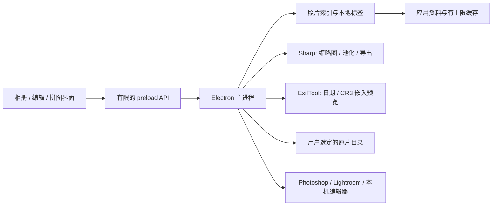

# 架构与第三方说明

拾光屿使用 Electron 提供 macOS / Linux 桌面窗口。界面负责选择、筛选、拖拽与进度展示；主进程负责文件访问、原生对话框、图像处理和外部应用交接。

## 文件与配对

索引记录照片文件位置、日期、类型和配对关系。JPEG 与 CR3 不合并、不转码成新的 RAW。标签、主题和收藏保存在应用资料中，浏览无需写入照片 EXIF。

外置盘上的目录可能断开，索引需要处理文件不可用的情况。删除必须对实际所选文件执行系统废纸篓操作；覆盖编辑只接受可编码的显示图像，并在成功生成结果后替换。原始 CR3 不能被裁剪后的 JPEG 覆盖。

## 缓存与图像处理

缩略图缓存以原文件标识和修改状态作为键。预渲染只保存小型显示资源，缓存受 512 MB 上限约束。使用顺序与限量任务队列避免一次解码所有文件。清理缓存不会删除原片或标签。

CR3 优先抽取内嵌 JPEG 预览。预览的分辨率、曝光、色调由相机决定；没有适用预览时显示明确失败状态。完整 RAW 显影、镜头校正和色彩管理交给专业编辑器。

相似搜索把每张显示图像缩到指定网格，转换为数值向量并计算余弦相似度。粗网格强调大块构图与颜色，细网格保留更多局部差异；它不提供人物身份识别或语义理解。搜索向量属于当前任务内存，不建立永久向量库。预计时间依据待扫描文件数计算，实际耗时受磁盘、CR3 预览和图像尺寸影响。

## 安全边界

Renderer 应禁用 Node integration，启用 context isolation，并通过固定 preload 方法调用主进程。动态文本使用安全 DOM API；外部文件 URL 只能访问已经加入图库或经对话框选中的路径。应用不远程加载网站。

外部编辑器由系统接口或可执行文件参数数组启动，不将文件名拼接到 shell 命令。Linux 文件管理器能力不同，能否精确选中多文件取决于桌面提供的 FileManager1 接口；macOS 使用 Finder 原生选中接口。

## 分发

`release.yml` 构建两种 Mac 架构，以及 Linux x64 AppImage / deb，然后在对应 runner 上启动打包后的应用运行合成图库界面测试；成功后统一核验预期文件名与校验和并写入草稿 Release。采用各架构原生 runner，Sharp 二进制跟随平台安装，避免跨架构的本地模块混用。

macOS 使用 ad-hoc 签名；不声明 Apple 公证或 Developer ID 身份。发布记录需区分单元测试、界面截图、打包完成和真实机器安装验收。GitHub runner 的可用标签依据 [GitHub 官方 runner 文档](https://docs.github.com/en/actions/reference/runners/github-hosted-runners)；避免即将停用的 macOS 14 runner。

## 第三方软件

主应用源代码采用仓库根目录的 MIT 许可证。依赖软件没有被重新授权；发行包保留依赖附带的许可证文件。

| 软件 | 用途 | 上游许可证说明 |
| --- | --- | --- |
| Electron | 桌面窗口、系统集成 | MIT；Chromium / Node.js 等组件另有随包 notices |
| Sharp / libvips | 缩放、编辑与拼图编码 | Sharp Apache-2.0；libvips LGPL-2.1-or-later，二进制附带其余组件条款 |
| exifr | 图像 EXIF 信息 | MIT |
| exiftool-vendored.js | ExifTool 调用封装 | MIT |
| ExifTool / exiftool-vendored.pl | RAW 日期与嵌入预览读取 | ExifTool 与 Perl 相同条款；npm 封装 MIT |
| electron-builder | 安装包构建工具 | MIT |

ExifTool 版权所有 Phil Harvey。其上游说明为：可以在与 Perl 本身相同的条款下再分发或修改，即 Perl Artistic License 或 GPL 双授权。不要把上游没有明确指定版本的 Artistic License 擅自写为 Artistic 2.0。

参考 [ExifTool 官方授权说明](https://exiftool.org/forum/index.php?topic=16703.0)、[ExifTool 源码](https://github.com/exiftool/exiftool) 与 [vendored.pl LICENSE](https://github.com/photostructure/exiftool-vendored.pl/blob/main/LICENSE)。本项目不修改 ExifTool 本体；发布时须保留依赖包中的原始版权和许可证资料。
