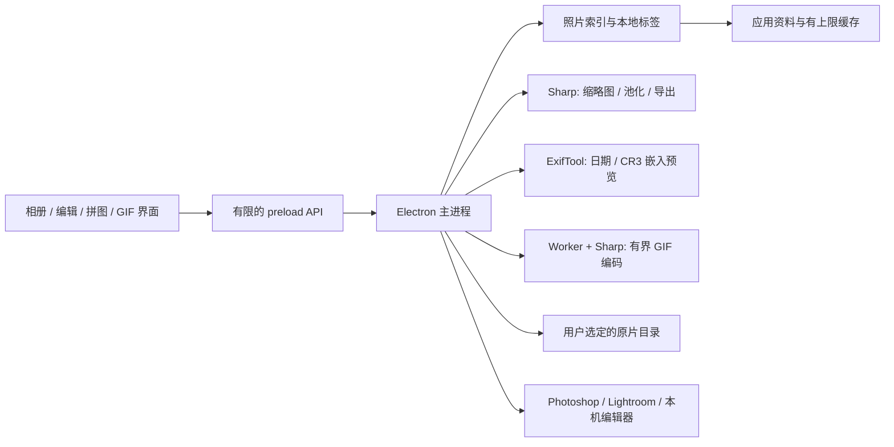

# 架构与第三方说明

时光杂货店使用 Electron 提供 macOS / Linux 桌面窗口。界面负责选择、筛选、拖拽与进度展示；主进程负责文件访问、原生对话框、图像处理和外部应用交接。

## 文件与配对

索引记录照片文件位置、日期、类型和配对关系。JPEG 与 CR3 不合并、不转码成新的 RAW。标签、主题和收藏保存在应用资料中，浏览无需写入照片 EXIF。

设置中的 `libraryRoots` 持久保存用户加入的多个照片目录；旧版单一 `libraryRoot` 迁移为一个已注册目录。添加目录只建立索引，移除目录只改变浏览范围，均不移动或删除原片，也不删除收藏与标签。重新加入同一目录会恢复本地标记。默认展示主题另存为 `defaultTheme`，导入成功后选择本次主题；普通添加与移除目录回到全部主题，避免不存在的目录名被用作主题筛选。

`PhotoLibrary.scanRoots()` 聚合注册目录的结果；临时相似搜索所授权的目录不会自动进入图库。重叠目录先采用更具体的目录，以实际文件路径去重，并补齐同组 JPEG / CR3；同名但不同目录的照片不会仅凭文件名合并。聚合结果中的照片、路径别名与实际可用照片 Map 一致，以保持缩略图访问和下次启动的身份、收藏及标签稳定。

外置盘断开或目录暂时不可读时，结果记录 `unavailableRoots`，继续显示其他可用目录。已注册路径及照片元数据保留，连接后刷新即可恢复。删除照片必须对实际所选文件执行系统废纸篓操作；覆盖编辑只接受可编码的显示图像，并在成功生成结果后替换。原始 CR3 不能被裁剪后的 JPEG 覆盖。

导入新照片时，来源与回忆根目录须经过原生文件夹选择器授权。准备枚举、读取拍摄信息、复制校验及索引阶段通过进度事件反馈，在窗口顶部显示，滚动图库后也可查看。来源文件始终保留；复制时跳过已有相同内容，但来源本身不作为已导入副本参与去重。空来源或全部重复时不提前创建空主题目录。成功导入只注册实际主题目录，不自动把整个回忆根目录或 SD 卡纳入相册。

当来源已经等于指定的同名主题目录时，走原位索引：扫描现有文件、在应用元数据中设置主题，不复制、不移动、不改写照片，也不强制重排日期子目录。来源与其他目标之间不允许相互嵌套，避免递归复制。取消会停止后续读取或复制，已完成副本保留并可纳入图库；任务清理在成功、取消及异常路径中都执行。

## 缓存与图像处理

缩略图缓存以原文件标识和修改状态作为键。预渲染只保存小型显示资源，缓存受 512 MB 上限约束。使用顺序与限量任务队列避免一次解码所有文件。清理缓存不会删除原片或标签。

CR3 优先抽取内嵌 JPEG 预览。预览的分辨率、曝光、色调由相机决定；没有适用预览时显示明确失败状态。完整 RAW 显影、镜头校正和色彩管理交给专业编辑器。

相似搜索把每张显示图像缩到指定网格，转换为数值向量并计算余弦相似度。粗网格强调大块构图与颜色，细网格保留更多局部差异；它不提供人物身份识别或语义理解。搜索向量属于当前任务内存，不建立永久向量库。预计时间依据待扫描文件数计算，实际耗时受磁盘、CR3 预览和图像尺寸影响。

拼图保留每张照片的构图状态与排序：固定格子可设置填满 / 完整放入、缩放及格内位置，缩略图换序同时移动这些状态。原比例杂志按照片比例计算行列，完整展示图像并保留独立标题区；木质展示板使用完整照片卡片，位置、尺寸、角度和图层次序参与同一份预览及导出布局，允许叠放。留白、胶片和原比例杂志共享每行张数设置，默认 2，允许 1–12。标题字号按导出宽度下的像素设置，成品等比缩小时一同缩放。

Alt / Option 滚轮缩放与画布平移仅改变显示变换，不改变导出尺寸。画布适配时可切换构图 / 换位模式，放大后普通拖动平移画布、Shift + 拖动调整照片；缩略图始终用于换序。输出长边不超过 24,000 px、面积不超过 4,800 万像素，超出时等比缩小。

分享压缩以最终成图宽度为预算：目标宽度为默认 1,440 px、清晰档 2,560 px 或自定义 480–8,000 px，取值不超过未压缩导出宽度；按布局原比例计算高度，完整保留纵向排版。随后应用每边 24,000 px / 总面积 4,800 万像素限制，必要时等比缩小，并在界面显示实际尺寸与安全限制原因。高度不受分享宽度数值直接限制，避免纵向长图因为长边预算而变得很窄。

原片逐张直接绘制到最终尺寸的 Canvas，启用高质量图像平滑，取消单张预缩小后再绘制的额外采样，最后仅编码一次 JPEG，默认品质 90%；不在照片目录保存中间副本。布局与设置有版本标识，过期生成结果不会成为当前成品。分享预览解码已生成的 JPEG 字节；保存请求通过 `preserveEncoding` 路径验证 JPEG 后写入同一份字节，避免保存时再次编码。分享视图默认按宽度适配，普通滚轮上下平移长图，仍保留窗口总览与 Alt / Option 缩放；这只是显示变换，不改变导出像素。宽度与品质由用户设置；匿名样本不能推出微信的统一算法、仅压横向的规则或免于二次压缩。所见即所得仅描述本应用的预览与导出文件，整幅压缩不改变模板已有的格子裁剪方式。

GIF 使用已有索引与路径授权选择 JPEG，CR3 原片不参与 GIF 编码。`motion-model.js` 共享画面、文字与气泡几何；主进程的 `GifService` 将已授权输入交给独立 Worker，使用 Sharp 顺序读取、缩放、叠加文字并编码真实多帧 GIF。照片完整放入画面，允许留白；可设置色彩数、统一帧时长、循环与尺寸比例。编码返回随机 token 和成品预览，保存该 token 对应的原始 GIF 字节；修改设置或关闭工作台会释放旧结果，不建立持久动图缓存。单张照片可另存为静态 JPEG 表情包。

GIF 请求限制为 2–80 帧、每边最多 1600 px、所有帧合计 2,400 万像素、最多 24 MB 编码结果；每帧最多 8 段文字或气泡。Worker 有超时及取消，任务进度回传界面。GIF 调色板最多 256 色，摄影渐变可能出现色带；界面编辑帧的全彩 Canvas 不替代真实编码后的 GIF 预览。

详情全屏通过固定的布尔 IPC 控制实际 Electron 窗口，而非只放大页面元素。进入时保存原窗口全屏状态，关闭或退出时恢复；JPEG / CR3 在全屏中选择一种预览显示，保留独立缩放和平移。F 切换全屏，Esc 优先退出全屏，再次按下关闭详情；左右切图交接当前全屏会话，系统主动退出全屏时也同步界面。CR3 始终显示相机内嵌预览，不进行 RAW 显影。操作细节见 [光影创作台](creative-studio.md)。

## 安全边界

Renderer 应禁用 Node integration，启用 context isolation，并通过固定 preload 方法调用主进程。动态文本使用安全 DOM API；外部文件 URL 只能访问已经加入图库或经对话框选中的路径。应用不远程加载网站。

外部编辑器由系统接口或可执行文件参数数组启动，不将文件名拼接到 shell 命令。Linux 文件管理器能力不同，能否精确选中多文件取决于桌面提供的 FileManager1 接口；macOS 使用 Finder 原生选中接口。

## 分发

`release.yml` 构建两种 Mac 架构，以及 Linux x64 AppImage / deb，然后在对应 runner 上启动打包后的应用运行合成图库界面测试；成功后统一核验预期文件名与校验和并写入草稿 Release。采用各架构原生 runner，Sharp 二进制跟随平台安装，避免跨架构的本地模块混用。

macOS 使用 ad-hoc 签名；不声明 Apple 公证或 Developer ID 身份。发布记录需区分单元测试、界面截图、打包完成和真实机器安装验收。GitHub runner 的可用标签依据 [GitHub 官方 runner 文档](https://docs.github.com/en/actions/reference/runners/github-hosted-runners)；避免即将停用的 macOS 14 runner。

## 应用内更新

更新服务在主进程访问固定官方仓库的最新正式 Release，按系统和架构选择准确文件名。Renderer 通过固定 API 接收状态、检查、下载和安装，不传入远程 URL 或任意安装目的地。v1.3.7 起自动更新默认开启，可在「相册设置 → 软件更新」关闭或开启；演示和安装包 QA 不自动访问网络。

正式安装的 Mac 和可写 AppImage 检测到新版后在后台下载并校验。更新准备好且界面空闲时显示 10 秒重启倒计时；导入、复制、扫描、导出、GIF 编码、选片及尚未关闭的详情、编辑或设置窗口会延后安装。任务或窗口结束后重新进入完整倒计时；关闭自动更新会取消自动重启。主进程还检查正在执行的 IPC、照片任务与设置保存，更新前等待设置和相册元数据落盘，防止后台更新打断前端尚未提交的构图或标签操作。用户仍可手动检查和安装。

下载使用 HTTPS、服务器白名单、容量与超时限制。校验表自身和安装包均核对 GitHub asset digest，并核对校验表对应 SHA-256。Mac ZIP 提取前检查路径和内部链接，提取后校验文件树、应用标识、版本、架构及签名。暂存及安装工作目录为隐藏的 `.noindex`，Mac 替换当前 Applications 内的 App、AppImage 替换自身文件，沿用原安装名及 userData，避免留下新的可搜索应用副本。

独立安装 helper 在旧进程退出后替换文件，保留回退备份并重新启动同一路径。收藏、标签、目录注册和设置留在原有应用资料中；Mac / AppImage 原位安装只备份设置与相册元数据，不备份照片或预览缓存。Linux deb 检测到新版时提醒，须由用户点击下载并打开系统安装器、完成系统授权及安装，之后手动重新打开应用，安装及恢复由系统包管理器负责。详情见 [中英文更新说明](updates.md)。系统的 Gatekeeper、签名或权限检查不因更新被关闭。

## 第三方软件

主应用源代码采用仓库根目录的 MIT 许可证。依赖软件没有被重新授权；发行包保留依赖附带的许可证文件。

| 软件 | 用途 | 上游许可证说明 |
| --- | --- | --- |
| Electron | 桌面窗口、系统集成 | MIT；Chromium / Node.js 等组件另有随包 notices |
| Sharp / libvips | 缩放、编辑与拼图编码 | Sharp Apache-2.0；libvips LGPL-2.1-or-later，二进制附带其余组件条款 |
| exifr | 图像 EXIF 信息 | MIT |
| exiftool-vendored.js | ExifTool 调用封装 | MIT |
| ExifTool / exiftool-vendored.pl | RAW 日期与嵌入预览读取 | ExifTool 与 Perl 相同条款；npm 封装 MIT |
| electron-builder | 安装包构建工具 | MIT |

ExifTool 版权所有 Phil Harvey。其上游说明为：可以在与 Perl 本身相同的条款下再分发或修改，即 Perl Artistic License 或 GPL 双授权。不要把上游没有明确指定版本的 Artistic License 擅自写为 Artistic 2.0。

参考 [ExifTool 官方授权说明](https://exiftool.org/forum/index.php?topic=16703.0)、[ExifTool 源码](https://github.com/exiftool/exiftool) 与 [vendored.pl LICENSE](https://github.com/photostructure/exiftool-vendored.pl/blob/main/LICENSE)。本项目不修改 ExifTool 本体；发布时须保留依赖包中的原始版权和许可证资料。

## Local color processing

`renderer/color-engine.js` is a deterministic, dependency-free sRGB pixel core shared by preview, export and Node regressions. A dedicated `color-worker.js` caches a bounded preview, computes histograms and a soft skin-color range, and applies shape-preserving RGB curves plus brightness-dependent temperature/tint offsets. Preview jobs coalesce and discard stale results. Export reuses the preview analysis at full working resolution and sends a lossless PNG through the existing authorized native save path; no intermediate JPEG is written. The native save path performs the final selected-format encode.

`photo-editor.js` separates immutable geometry canvases from curve/skin settings and bounded undo history. Sampling narrows a color range rather than locating a face. Mask and before views are excluded from export. Closing terminates the worker, rejects outstanding jobs and releases working canvases. Source decoding and geometry operations retain the existing safe canvas bounds. Compatibility-sensitive application IDs, library metadata and CR3 authorization are unchanged.
