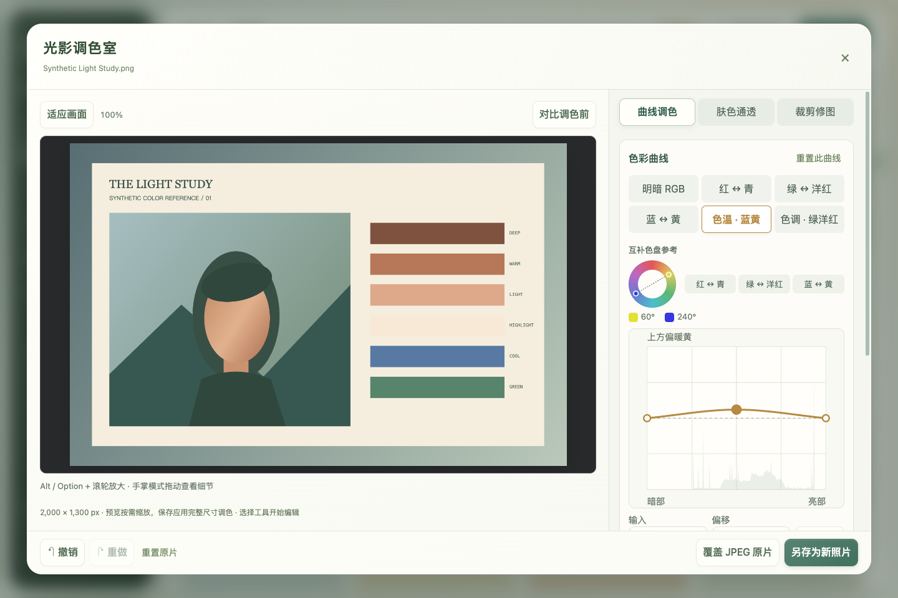
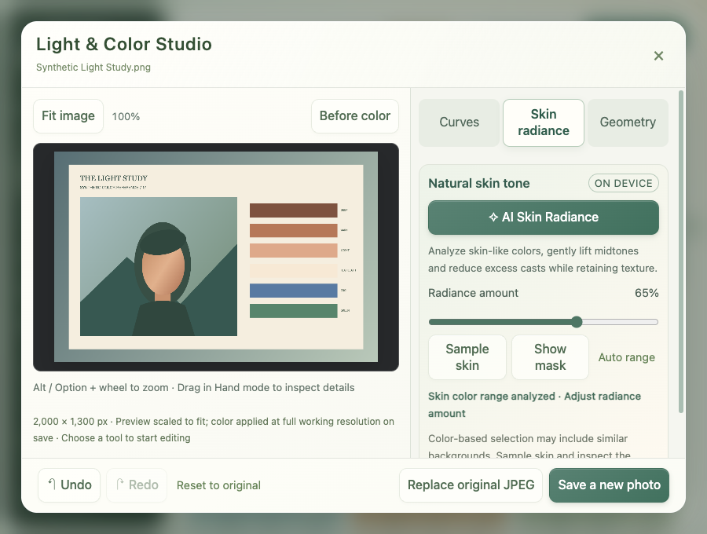

# Light & Color Studio / 光影调色室

## English

Open a JPEG's detail view and choose **Color & edit**. The editor has three tabs: **Curves**, **Skin radiance**, and **Geometry**. The complementary wheel sits with the curves so the reference stays close to the adjustment.

- **Tone RGB, Red, Green, Blue:** click the graph to add a control point and drag to change it. Numeric Input / Output fields offer precise control. Arrow keys move a point by one step, Shift moves faster, and Delete or double-click removes an interior point. Endpoints stay horizontally anchored. Each channel supports up to 16 points, with a bounded smooth interpolation.
- **Temperature and Tint curves:** the horizontal axis represents the original image's brightness; the center line means zero change. Raise Temperature for warmer yellow, lower it for cooler blue. Raise Tint for magenta, lower it for green. This lets shadows, midtones and highlights receive different offsets. The two sliders below apply an overall offset. These are relative JPEG corrections, not a camera Kelvin setting or RAW development.
- **Complementary reference:** explore the opposite hues with the wheel, or choose Red–Cyan, Green–Magenta and Blue–Yellow to select that channel. The wheel is a creative sRGB reference, not a monitor calibration tool.
- **AI Skin Radiance:** click once, then adjust Amount. The name describes a one-click tool; it uses deterministic local color analysis, with no AI model, account, upload or online service. It detects a soft range of skin-like colors, adapts a restrained midtone lift to that range, and slightly reduces excess red/yellow casts. It does not blur or smooth skin texture.
- **Sample skin / Show mask:** sample a skin area if automatic selection is unsuitable. The cyan overlay shows the selected color range and is excluded from exports. This is color selection, not face segmentation: wood, sand or clothing with similar colors may also be affected. Sampling narrows the color range, not a spatial selection. Lower Amount or undo if the result does not suit the photograph. Different lighting and skin tones require judgment.
- **Before color, undo and redo:** compare the ungraded working image while retaining any geometry edits. Undo / redo handles both color and geometry changes. Reset returns to the original image. Alt / Option + wheel zooms in; Hand mode pans the view.
- **Save as / overwrite:** save a new image or explicitly confirm replacement of the JPEG. CR3 is untouched. Exports follow the existing canvas workflow and do not preserve the source EXIF metadata.

Preview calculation and export share the same processing core and color analysis. Previews are bounded to 1.6 megapixels / a 1,600-pixel side and computed in a worker. Export applies settings to the full working canvas; source images larger than 48 megapixels or a 24,000-pixel side are reduced to the safe canvas limit, with a visible notice. In-memory lossless PNG transport avoids an intermediate JPEG encode before the chosen file format is saved. Closing the editor terminates its worker and releases the working buffers; unsaved editing does not create intermediate image files. Geometry undo buffers have a bounded history and may discard the oldest steps on very large images.

## 简体中文

打开 JPEG 的照片详情，点击 **“调色与修图”**。编辑器分为 **曲线调色、肤色通透、裁剪修图** 三页；互补色盘与曲线放在同一页，方便对照。

- **明暗 RGB、红、绿、蓝曲线：** 点击图表加点，拖动节点调整；也能直接填写输入、输出数值。方向键微调，Shift 加速，Delete 或双击删除内部节点。两端节点的横坐标固定。每条曲线最多 16 个节点，使用平滑且不会超出相邻节点范围的插值。
- **色温、色调曲线：** 横轴是原图亮度，中间虚线代表不偏移。色温上提偏暖黄、下压偏冷蓝；色调上提偏洋红、下压偏绿。可以分别处理暗部、中间调与亮部；下方滑块控制整体偏移。这里是 JPEG 的相对修正，不是相机的开尔文色温或 RAW 显影。
- **互补色盘：** 点击或用方向键选择色相，查看其相对的颜色；点击红–青、绿–洋红、蓝–黄，切换对应通道。它是 sRGB 创作参考，不是显示器校色工具。
- **AI 一键通透：** 一键分析后可调整强度。虽然名称含 AI，实际使用本地色彩算法，无需模型、账户、上传或联网。通过柔和的肤色范围识别，自适应提亮中间调，并适度收敛偏红、偏黄；不磨皮、不模糊纹理。
- **取样肤色、查看范围：** 自动范围不合适时，可点击皮肤取样。青色覆盖表示所选色彩范围，不会被保存到成品里。它按颜色识别，并非人脸分割，木头、沙地、衣服等相近颜色也可能被调整。取样缩小的是色彩范围，并不会限制到某一个人的局部区域。根据光线和肤色调整强度，不合适可直接撤销。
- **对比与撤销：** “对比调色前”显示未调色的工作图，保留已做的裁剪、旋转等操作。颜色和几何调整都支持撤销、重做；重置返回原图。Alt / Option + 滚轮查看细节，手掌模式拖动画面。
- **保存：** 可以另存为，也可确认后覆盖 JPEG；CR3 保留。沿用画布导出的保存方式，不保留原片 EXIF 信息。

预览与导出共用同一套调色算法和分析参数。预览最多 160 万像素、单边 1,600 像素，在后台计算；保存时应用到完整工作画布。超过 4,800 万像素或单边 24,000 像素的原图，会缩小到安全画布，并在界面提示。保存前用内存中的无损 PNG 传递结果，避免先压一次 JPEG 再重新编码。关闭编辑器会停止计算并释放工作缓存；放弃编辑不会留下中间图片文件。几何操作撤销有内存上限，超大图片的最旧步骤可能被丢弃。

Interaction references / 交互参考：[Adobe Curves](https://helpx.adobe.com/photoshop/using/curves-adjustment.html), [Adobe white balance](https://www.adobe.com/learn/lightroom-cc/web/remove-color-cast). Shutter Cove implements its own processing; these references do not imply equivalent color science or RAW support.
