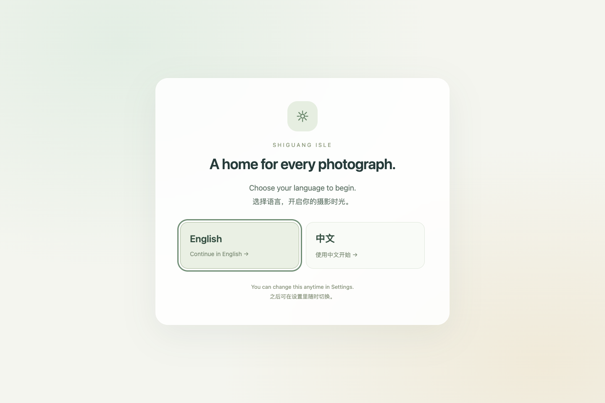

# Interface and documentation languages

Shiguang Isle supports **English** and **Simplified Chinese** throughout the desktop application. Open **Settings → Interface language** and select English or 中文. Changes apply immediately and are saved independently of other unsaved settings fields.

A fresh profile defaults to English and must choose a language before the first-use guide. Upgrading an existing Chinese profile keeps Chinese. Restarting uses the saved choice; the chooser is not shown again after a successful choice.

The language setting does not modify photograph filenames, library paths, themes, tags, camera metadata, poster titles, or captions you have entered. Changing languages does not reset an open collage, GIF session, or photo view.

**Documentation:** [English](../README.md) · [简体中文](../README.zh-CN.md) · [日本語](../README.ja.md) · [한국어](../README.ko.md). Japanese and Korean guides are translations of usage documentation; those interface languages are not supported in this version. Additional languages may be added according to demand.

# 界面与说明语言

桌面应用支持**简体中文**与 **English**。打开**设置 → 界面语言**即可一键切换并保存，不影响其他尚未保存的设置草稿。

新资料默认英文，首次打开先选择语言，再进入使用引导。已有中文资料升级后保留中文；以后重启使用已保存的选择，不再重复显示语言选择。

语言切换不会改动照片文件名、相册路径、主题、标签、相机信息，以及你输入的海报标题和字幕；也不会重置打开的拼图、GIF 或详情会话。日韩使用说明为翻译版，当前 App 尚不支持日韩界面，后续根据需求增加语言。
